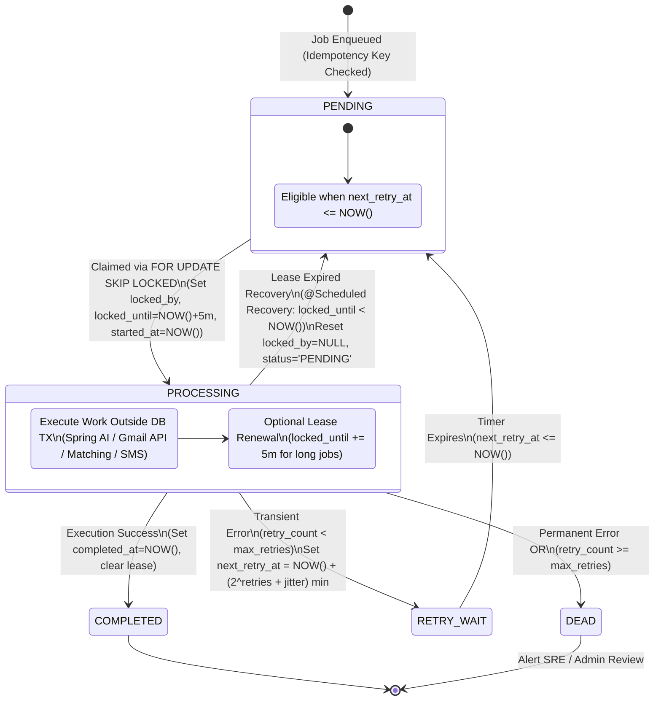

# InboxIQ – Background Processing & Lease-Based Queue Architecture (BACKGROUND-PROCESSING-v2.md)
**PostgreSQL Durable Job Queue, Concurrency Control & Crash Recovery**

---

## 1. Background Processing Architectural Philosophy

InboxIQ deliberately excludes external message brokers (such as RabbitMQ, Kafka, or AWS SQS) for the MVP. Instead, it utilizes a battle-tested **PostgreSQL-backed persistent job queue** combined with Java 21 thread pools.

### Core Architectural Rules
1. **PostgreSQL is the Sole Source of Truth:** Jobs are never purely in-memory. An unhandled JVM crash, pod eviction, or deployment restart will never lose pending or in-progress jobs.
2. **Short DB Transactions for Claims:** Database locks are held strictly for milliseconds to update job state and acquire a lease.
3. **Execution Strictly Outside Database Transactions:** External HTTP calls (Gemini AI inference, Gmail API downloads, Twilio SMS dispatches) **must never run inside a database transaction**, eliminating database connection pool starvation.
4. **Lease-Based Worker Ownership:** Workers acquire time-bounded leases (`locked_until`), replacing fragile `started_at` threshold heuristics.

---

## 2. Job Lifecycle State Machine



---

## 3. Supported Job Types & Idempotency Key Design (Correction 6)

| Job Type | Target Type | Description | Idempotency Key Format |
|---|---|---|---|
| `CLASSIFY_EMAIL` | `EMAIL` | Runs Gemini AI classification and entity extraction. | `"CLASSIFY:" \|\| email_id` |
| `MATCH_EMAIL` | `EMAIL` | Runs user preference matching and relevance scoring. | `"MATCH:" \|\| email_id` |
| `SEND_NOTIFICATION` | `NOTIFICATION` | Dispatches SMS/Email alerts to configured providers. | `"NOTIFY:" \|\| notification_id` |
| `SYNC_ACCOUNT` | `CONNECTED_ACCOUNT` | Ingests new emails from Gmail via History API. | `"SYNC:" \|\| account_id \|\| ":" \|\| sync_timestamp` |
| `RECLASSIFY_EMAIL` | `EMAIL` | Triggers upgraded model classification on an existing email. | `"RECLASSIFY:" \|\| email_id \|\| ":" \|\| prompt_version` |

The unique constraint `uq_pj_idempotency UNIQUE (idempotency_key)` prevents duplicate jobs from being queued even if multiple webhooks or sync timers fire simultaneously.

---

## 4. Lease-Based Claiming & Worker Execution (Correction 7)

### 4.1 Step 1: Claiming with `FOR UPDATE SKIP LOCKED`
Every 5 seconds, the `JobDispatcherService` claims eligible jobs using row-level locking:
```sql
WITH claimable AS (
    SELECT id
    FROM processing_jobs
    WHERE status IN ('PENDING', 'RETRY_WAIT')
      AND next_retry_at <= NOW()
    ORDER BY priority ASC, created_at ASC
    FOR UPDATE SKIP LOCKED
    LIMIT 10
)
UPDATE processing_jobs pj
SET status = 'PROCESSING',
    locked_by = :workerInstanceId,
    locked_until = NOW() + INTERVAL '5 minutes',
    started_at = NOW(),
    updated_at = NOW()
FROM claimable
WHERE pj.id = claimable.id
RETURNING pj.*;
```
- Multiple backend nodes or worker threads can execute this query concurrently without blocking or deadlocking one another.
- The transaction commits immediately, releasing row locks and returning claimed records to the dispatcher.

### 4.2 Step 2: Bounded Execution Buffer
Claimed jobs are handed over to an in-memory `ThreadPoolTaskExecutor`:
- **Core Pool Size:** 3 threads
- **Max Pool Size:** 8 threads
- **Queue Capacity:** 50 items (`ArrayBlockingQueue`)
- If the thread pool is saturated, the dispatcher pauses claiming until slots open, preventing JVM `OutOfMemoryError`.

### 4.3 Step 3: Execution & Lease Renewal
The worker executes the business logic (e.g., calling Gemini API). If a job takes longer than 3 minutes (e.g., an initial mailbox sync with 100 emails):
```sql
UPDATE processing_jobs
SET locked_until = NOW() + INTERVAL '5 minutes'
WHERE id = :jobId AND locked_by = :workerInstanceId;
```

### 4.4 Step 4: Completion or Exponential Retry with Jitter
- **On Success:**
  ```sql
  UPDATE processing_jobs
  SET status = 'COMPLETED', locked_by = NULL, locked_until = NULL, completed_at = NOW()
  WHERE id = :jobId;
  ```
- **On Transient Failure (e.g., Gemini 429 Rate Limit, Socket Timeout):**
  Calculate delay using truncated exponential backoff plus randomized jitter:
  $$\text{Delay} = 2^{\text{retry\_count}} \text{ minutes} + \text{random}(0, 30) \text{ seconds}$$
  If `retry_count < 5`:
  ```sql
  UPDATE processing_jobs
  SET status = 'RETRY_WAIT',
      retry_count = retry_count + 1,
      next_retry_at = NOW() + :calculatedDelay,
      locked_by = NULL,
      locked_until = NULL,
      last_error = :sanitizedErrorMessage
  WHERE id = :jobId;
  ```
  If `retry_count >= 5`:
  ```sql
  UPDATE processing_jobs
  SET status = 'DEAD', locked_by = NULL, locked_until = NULL, last_error = :sanitizedErrorMessage
  WHERE id = :jobId;
  ```

---

## 5. Crash Recovery & Abandoned Job Reclamation

If a container crashes, is killed by an OOM event, or is restarted during deployment while holding active jobs, those jobs remain marked as `PROCESSING`.

### Recovery Daemon (`JobRecoveryService`)
Runs every 2 minutes:
```sql
UPDATE processing_jobs
SET status = 'PENDING',
    locked_by = NULL,
    locked_until = NULL,
    next_retry_at = NOW(),
    updated_at = NOW()
WHERE status = 'PROCESSING'
  AND locked_until < NOW();
```
Because the lease expired (`locked_until < NOW()`), the recovery service safely resets the job to `PENDING` without risking dual execution with a slow-running worker.

---

## 6. Cloud Run Scale-to-Zero Deployment Resolution (Correction 16)

### 6.1 The Problem
Google Cloud Run automatically scales container instances to zero when no HTTP requests arrive. In an unconfigured environment, in-process background worker threads freeze, halting email classification and notifications.

### 6.2 Production Solution
1. **Cloud Run Service Configuration:**
   - Deploy the unified modular monolith container with `--min-instances=1` and `--no-cpu-throttling` (`cpu-always-allocated: true`). This guarantees that background worker threads run continuously without freezing.
2. **Cloud Scheduler Fallback Heartbeat:**
   - Cloud Scheduler dispatches an authenticated HTTP POST request to `/api/v1/internal/jobs/heartbeat` every 1 minute.
   - This serves as an automated heartbeat, ensuring that even if staging instances scale to zero, pending emails are processed within 60 seconds.

