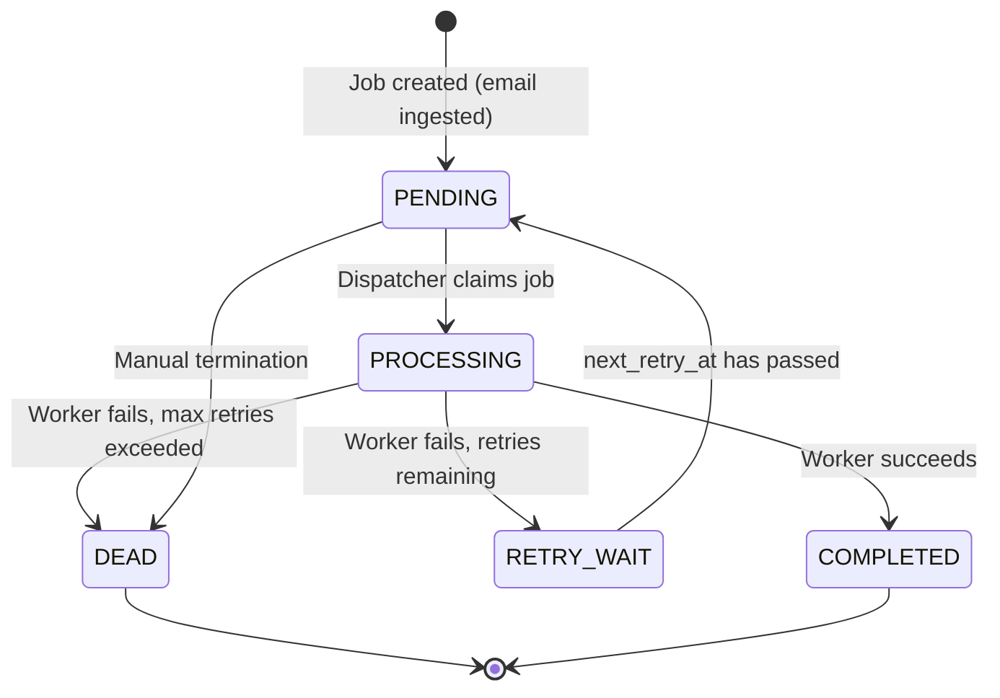

# InboxIQ – Background Processing System

## 1. Overview

InboxIQ uses **PostgreSQL as the durable job store** — no RabbitMQ, no Redis, no external message broker. All job state is persisted in the `processing_jobs` table, which survives application restarts, crashes, and horizontal scaling.

**Architecture summary:**
- `processing_jobs` table = durable, persistent job registry (source of truth)
- `BlockingQueue<ProcessingJob>` = in-memory execution buffer (transient, bounded)
- `JobDispatcherService` = polls DB → claims jobs → pushes to queue
- `JobWorkerService` = thread pool → pulls from queue → executes jobs
- `JobRecoveryService` = detects and recovers abandoned jobs after crashes

> [!IMPORTANT]
> The `BlockingQueue` is **not** a replacement for the database. It is an execution buffer only. If the application crashes, jobs in the queue are lost — but they remain in `PROCESSING` state in the DB and are recovered by `JobRecoveryService`.

---

## 2. Job Lifecycle



### State Descriptions

| State | Meaning |
|---|---|
| `PENDING` | Job is queued and waiting to be claimed by the dispatcher |
| `PROCESSING` | Job has been claimed and is being executed (or was claimed before a crash) |
| `COMPLETED` | Job finished successfully |
| `RETRY_WAIT` | Job failed but has retries remaining; waiting until `next_retry_at` |
| `DEAD` | Job failed and exhausted all retry attempts; requires manual investigation |

---

## 3. Job Dispatcher (`JobDispatcherService`)

The dispatcher is a scheduled poller that claims available jobs from the database and feeds them to the worker queue.

### Schedule
```java
@Scheduled(fixedDelayString = "${jobs.dispatch.interval-ms:5000}")  // 5 seconds default
public void dispatch() { ... }
```

### Claim Query
```sql
SELECT *
FROM processing_jobs
WHERE status IN ('PENDING', 'RETRY_WAIT')
  AND next_retry_at <= NOW()
ORDER BY priority ASC, created_at ASC
FOR UPDATE SKIP LOCKED
LIMIT 10;
```

**Key design decisions:**
- `FOR UPDATE SKIP LOCKED` — atomically claims rows; multiple dispatcher instances (horizontal scaling) can safely run concurrently without claiming the same job
- `priority ASC` — lower priority number = higher urgency (1 = urgent, 5 = background)
- `next_retry_at <= NOW()` — retried jobs only become claimable after their backoff period expires
- `LIMIT 10` — prevents the dispatcher from pulling an unbounded number of jobs in one cycle

### Claim Process (single transaction)
```java
@Transactional
public List<ProcessingJob> claimJobs() {
    List<ProcessingJob> jobs = jobRepository.findAndLockAvailableJobs(10);
    jobs.forEach(job -> {
        job.setStatus(JobStatus.PROCESSING);
        job.setStartedAt(Instant.now());
    });
    return jobRepository.saveAll(jobs);
}
```

### Queue Handoff
After claiming, jobs are submitted to the `BlockingQueue`:
```java
for (ProcessingJob job : claimed) {
    boolean accepted = jobQueue.offer(job);  // non-blocking
    if (!accepted) {
        // Queue is full — release job back to PENDING
        job.setStatus(JobStatus.PENDING);
        job.setStartedAt(null);
        jobRepository.save(job);
        log.warn("Job queue full, releasing job {} back to PENDING", job.getId());
    }
}
```

> [!NOTE]
> The dispatcher **never blocks** on the queue. If the queue is full, jobs are released back to `PENDING` and will be picked up on the next dispatch cycle. This prevents the dispatcher thread from stalling.

### Configuration
```yaml
jobs:
  dispatch:
    interval-ms: ${JOB_DISPATCH_INTERVAL_MS:5000}
    batch-size: ${JOB_DISPATCH_BATCH_SIZE:10}
  queue:
    capacity: ${JOB_QUEUE_CAPACITY:50}
```

---

## 4. Worker Thread Pool (`JobWorkerService`)

Workers are daemon threads that continuously pull from the `BlockingQueue` and execute jobs.

### Thread Pool Configuration
```java
@Bean
public ThreadPoolTaskExecutor jobWorkerExecutor() {
    ThreadPoolTaskExecutor executor = new ThreadPoolTaskExecutor();
    executor.setCorePoolSize(3);    // ${JOB_WORKER_CORE_THREADS:3}
    executor.setMaxPoolSize(5);     // ${JOB_WORKER_MAX_THREADS:5}
    executor.setQueueCapacity(0);   // No internal queue — we use our own BlockingQueue
    executor.setThreadNamePrefix("job-worker-");
    return executor;
}
```

### Worker Loop
```java
// Each worker thread runs this loop
public void runWorker() {
    while (!Thread.currentThread().isInterrupted()) {
        ProcessingJob job = jobQueue.take();  // blocks until job available
        executeJob(job);
    }
}
```

### On Success
```java
@Transactional
private void handleSuccess(ProcessingJob job) {
    job.setStatus(JobStatus.COMPLETED);
    job.setCompletedAt(Instant.now());
    jobRepository.save(job);
    
    createAttemptRecord(job, true, null);
}
```

### On Failure
```java
@Transactional
private void handleFailure(ProcessingJob job, Exception e) {
    job.setRetryCount(job.getRetryCount() + 1);
    
    if (job.getRetryCount() >= job.getMaxRetries()) {
        job.setStatus(JobStatus.DEAD);
        alertAdminService.notifyDeadJob(job, e);
    } else {
        // Exponential backoff: 2^retryCount minutes
        long backoffMinutes = (long) Math.pow(2, job.getRetryCount());
        job.setStatus(JobStatus.RETRY_WAIT);
        job.setNextRetryAt(Instant.now().plusSeconds(backoffMinutes * 60));
    }
    
    job.setLastError(truncate(e.getMessage(), 500));
    jobRepository.save(job);
    
    createAttemptRecord(job, false, e.getMessage());
}
```

### Retry Backoff Schedule

| Retry Attempt | Wait Time |
|---|---|
| 1st retry | 2 minutes |
| 2nd retry | 4 minutes |
| 3rd retry | 8 minutes |
| 4th retry | 16 minutes |
| 5th retry | 32 minutes |
| 6th retry | DEAD |

Default `max_retries = 5`. Configurable per job type.

### Processing Attempt Records
Every execution attempt (success or failure) is recorded:
```sql
INSERT INTO processing_attempts (
    job_id, attempt_number, started_at, completed_at,
    success, error_message, duration_ms
) VALUES (...);
```

This provides a full audit trail for debugging failed jobs.

---

## 5. Recovery After Restart (`JobRecoveryService`)

If the application crashes while jobs are `PROCESSING`, those jobs are stuck — the workers that owned them are gone. `JobRecoveryService` detects and recovers them.

### Schedule
```java
@Scheduled(fixedDelayString = "${jobs.recovery.interval-ms:600000}")  // 10 minutes
public void recoverAbandonedJobs() { ... }
```

### Recovery Query
```sql
SELECT *
FROM processing_jobs
WHERE status = 'PROCESSING'
  AND started_at < NOW() - INTERVAL '15 minutes';
```

**15 minutes** is chosen because:
- No legitimate job should take more than 15 minutes (AI classification is typically < 30 seconds)
- 15 minutes provides sufficient buffer for slow Gemini API responses
- Configurable via `JOB_RECOVERY_THRESHOLD_MINUTES`

### Recovery Action
```java
@Transactional
public void recoverAbandonedJobs() {
    List<ProcessingJob> abandoned = jobRepository.findAbandonedJobs(15);
    
    abandoned.forEach(job -> {
        log.warn("Recovering abandoned job: id={}, type={}, startedAt={}",
                 job.getId(), job.getJobType(), job.getStartedAt());
        
        job.setStatus(JobStatus.PENDING);
        job.setStartedAt(null);
        job.setNextRetryAt(Instant.now());  // Eligible for immediate re-dispatch
    });
    
    jobRepository.saveAll(abandoned);
    
    if (!abandoned.isEmpty()) {
        log.warn("Recovered {} abandoned jobs", abandoned.size());
    }
}
```

> [!NOTE]
> Recovery resets the job to `PENDING` without incrementing `retry_count`. A crash is not the job's "fault." Only worker-detected failures increment the retry counter.

---

## 6. Duplicate Prevention

### Idempotency Keys
Every job has an `idempotency_key` that prevents duplicate job creation:

| Job Type | Idempotency Key Pattern |
|---|---|
| Email classification | `EMAIL_CLASSIFICATION:{email_id}` |
| Gmail full sync | `GMAIL_FULL_SYNC:{connected_account_id}` |
| Notification dispatch | `NOTIFICATION:{email_id}:{user_id}` |

### Duplicate-Safe Insert
```sql
INSERT INTO processing_jobs (idempotency_key, job_type, payload, ...)
VALUES ('EMAIL_CLASSIFICATION:550e8400-...', 'EMAIL_CLASSIFICATION', '{}', ...)
ON CONFLICT (idempotency_key) DO NOTHING;
```

If a job for this email already exists (pending, processing, or completed), the insert silently does nothing. This means:
- Running sync twice quickly → only one classification job created
- Application restart mid-sync → duplicate email attempt → deduplicated at both email and job level

---

## 7. Transaction Strategy

| Operation | Transaction Scope |
|---|---|
| **Email save + job create** | Single transaction — email is never saved without a job, and a job is never created without an email |
| **Job claim** | Single transaction — `SELECT FOR UPDATE SKIP LOCKED` + `UPDATE status=PROCESSING` |
| **Job success** | Single transaction — `UPDATE status=COMPLETED` + `INSERT attempt record` |
| **Job failure** | Single transaction — `UPDATE status=RETRY_WAIT/DEAD` + `INSERT attempt record` |
| **Recovery** | Single transaction — bulk `UPDATE status=PENDING` |

### Email + Job Atomicity
```java
@Transactional
public void saveEmailWithJob(Email email, ConnectedAccount account) {
    // If either fails, both roll back
    emailRepository.save(email);
    
    ProcessingJob job = ProcessingJob.builder()
        .jobType(JobType.EMAIL_CLASSIFICATION)
        .idempotencyKey("EMAIL_CLASSIFICATION:" + email.getId())
        .payload(Map.of("emailId", email.getId()))
        .priority(2)
        .maxRetries(5)
        .build();
    
    jobRepository.insertIgnoreConflict(job);  // ON CONFLICT DO NOTHING
}
```

---

## 8. Monitoring Points

The following metrics should be exposed via Spring Actuator (and scraped by Prometheus in production):

| Metric | Type | Description |
|---|---|---|
| `processing_jobs_pending_count` | Gauge | Current count of PENDING jobs |
| `processing_jobs_processing_count` | Gauge | Current count of PROCESSING jobs |
| `processing_jobs_retry_wait_count` | Gauge | Current count of RETRY_WAIT jobs |
| `processing_jobs_dead_count` | Gauge | Cumulative count of DEAD jobs (alert threshold) |
| `processing_duration_ms` | Histogram | Time taken to complete a job, by job type |
| `ai_api_calls_total` | Counter | Total Gemini API calls made |
| `ai_api_errors_total` | Counter | Total Gemini API errors, by error type |
| `job_queue_size` | Gauge | Current in-memory BlockingQueue depth |
| `jobs_recovered_total` | Counter | Total jobs recovered from PROCESSING state |

> [!TIP]
> Set up an alert for `processing_jobs_dead_count > 0`. Dead jobs always require investigation — they indicate either a persistent AI error, a data quality issue, or a bug in the processing logic.

### Health Check
Spring Actuator health endpoint should include a custom `JobSystemHealthIndicator`:
```java
// Reports DOWN if dead job count exceeds threshold, or dispatcher has not run in > 2 minutes
```
