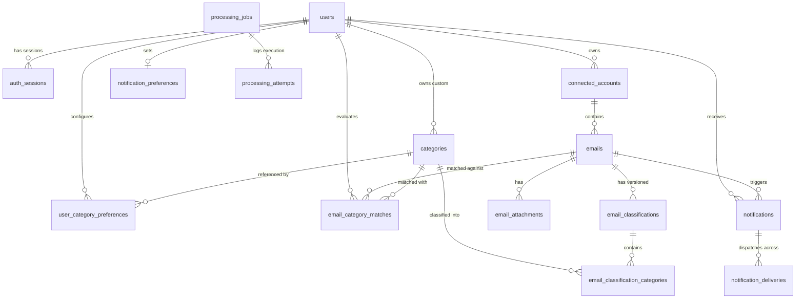

# InboxIQ – Database Architecture Specification (DATABASE-v2.md)
**PostgreSQL Relational Schema & Integrity Specification**

---

## 1. Overview & Architectural Principles

The InboxIQ database is designed around strict relational integrity, multi-tenant isolation, auditable background processing, and high-concurrency background job handling.

### Core Principles
- **Engine:** PostgreSQL 15+
- **Primary Keys:** UUID v4 (`gen_random_uuid()`) exclusively across all tables to prevent ID enumeration attacks and simplify distributed replication.
- **Timestamps:** `TIMESTAMPTZ` (UTC) exclusively across all tables for unambiguous chronological auditing.
- **Controlled JSONB:** Used strictly for polymorphic, category-specific configuration and AI-extracted entity structures. Relational foreign keys and indexes remain normalized.
- **Partial Unique Indexes:** Used to enforce complex business rules (e.g., exactly one current classification per email, per-user uniqueness of custom category names).
- **Flyway Migrations:** Schema changes are version-controlled strictly via sequential Flyway SQL scripts (`V1__...sql`). Hibernate `ddl-auto` is set to `validate` in all environments.
- **Zero Ingestion/AI Coupling:** Table transactions during job ingestion never block on external LLM or SMS network operations.

---

## 2. Entity-Relationship Diagram (ERD)



---

## 3. Comprehensive Table Definitions (15 Core Tables)

### 3.1 Table: `users`
**Purpose:** Core user account for InboxIQ web application authentication and account lifecycle.

| Column | Type | Nullable | Default | Description |
|---|---|---|---|---|
| `id` | UUID | NO | `gen_random_uuid()` | Primary Key |
| `email` | VARCHAR(255) | NO | - | Unique login email (lowercased) |
| `password_hash` | VARCHAR(255) | NO | - | BCrypt hash (cost factor 12) |
| `full_name` | VARCHAR(255) | NO | - | User display name |
| `phone_number` | VARCHAR(20) | YES | NULL | E.164 phone number for SMS alerts |
| `phone_verified` | BOOLEAN | NO | `false` | SMS destination verification flag |
| `is_active` | BOOLEAN | NO | `true` | Soft-deletion / suspension flag |
| `email_verified` | BOOLEAN | NO | `false` | Account email confirmation flag |
| `last_login_at` | TIMESTAMPTZ | YES | NULL | Last successful login timestamp |
| `created_at` | TIMESTAMPTZ | NO | `NOW()` | Audit record creation timestamp |
| `updated_at` | TIMESTAMPTZ | NO | `NOW()` | Audit record modification timestamp |

- **Constraints:**
  - `pk_users PRIMARY KEY (id)`
  - `uq_users_email UNIQUE (email)`
- **Indexes:**
  - `idx_users_email ON users (email)`

---

### 3.2 Table: `auth_sessions`
**Purpose:** Persistent refresh tokens and active user login sessions with family-based reuse detection.

| Column | Type | Nullable | Default | Description |
|---|---|---|---|---|
| `id` | UUID | NO | `gen_random_uuid()` | Primary Key |
| `user_id` | UUID | NO | - | FK to `users(id)` ON DELETE CASCADE |
| `token_hash` | VARCHAR(64) | NO | - | SHA-256 hash of opaque refresh token |
| `token_family_id` | UUID | NO | - | UUID grouping rotated tokens in one lineage |
| `expires_at` | TIMESTAMPTZ | NO | - | Refresh token expiry timestamp (7 days) |
| `revoked_at` | TIMESTAMPTZ | YES | NULL | Revocation timestamp if logged out/rotated |
| `replaced_by_token_id`| UUID | YES | NULL | Pointer to child session created upon rotation |
| `ip_address` | VARCHAR(45) | YES | NULL | Client IP for audit logging |
| `user_agent` | VARCHAR(500) | YES | NULL | Client user agent string |
| `created_at` | TIMESTAMPTZ | NO | `NOW()` | Session generation timestamp |
| `last_used_at` | TIMESTAMPTZ | NO | `NOW()` | Last token exchange timestamp |

- **Constraints:**
  - `pk_auth_sessions PRIMARY KEY (id)`
  - `fk_auth_sessions_user FOREIGN KEY (user_id) REFERENCES users(id) ON DELETE CASCADE`
  - `uq_auth_sessions_token_hash UNIQUE (token_hash)`
- **Indexes:**
  - `idx_auth_sessions_user ON auth_sessions (user_id)`
  - `idx_auth_sessions_family ON auth_sessions (token_family_id)`
  - `idx_auth_sessions_active ON auth_sessions (token_hash) WHERE revoked_at IS NULL`

---

### 3.3 Table: `connected_accounts`
**Purpose:** Stores Google OAuth 2.0 authorization grants and encrypted credentials per connected Gmail mailbox.

| Column | Type | Nullable | Default | Description |
|---|---|---|---|---|
| `id` | UUID | NO | `gen_random_uuid()` | Primary Key |
| `user_id` | UUID | NO | - | FK to `users(id)` ON DELETE CASCADE |
| `provider` | VARCHAR(50) | NO | `'GOOGLE'` | Identity provider identifier |
| `provider_account_id` | VARCHAR(255) | NO | - | Google Subject ID (`sub`) |
| `email_address` | VARCHAR(255) | NO | - | Connected Gmail address |
| `display_name` | VARCHAR(255) | YES | NULL | User's profile name from Google |
| `refresh_token_ciphertext`| TEXT | NO | - | AES-256-GCM encrypted refresh token |
| `encryption_key_version` | VARCHAR(50) | NO | `'v1'` | Key version identifier for key rotation |
| `nonce_iv` | VARCHAR(64) | NO | - | 96-bit random IV/nonce (Hex-encoded) |
| `auth_tag` | VARCHAR(64) | NO | - | 128-bit GCM authentication tag (Hex-encoded)|
| `scopes` | TEXT[] | NO | `'{}'` | Granted OAuth scopes |
| `sync_status` | VARCHAR(50) | NO | `'IDLE'` | `IDLE`, `SYNCING`, `FAILED`, `DISCONNECTING` |
| `last_sync_at` | TIMESTAMPTZ | YES | NULL | Timestamp of last successful sync cycle |
| `last_history_id` | VARCHAR(100) | YES | NULL | Gmail History API cursor for incremental sync |
| `is_active` | BOOLEAN | NO | `true` | Active status flag |
| `created_at` | TIMESTAMPTZ | NO | `NOW()` | Record creation timestamp |
| `updated_at` | TIMESTAMPTZ | NO | `NOW()` | Record modification timestamp |

- **Constraints:**
  - `pk_connected_accounts PRIMARY KEY (id)`
  - `fk_connected_accounts_user FOREIGN KEY (user_id) REFERENCES users(id) ON DELETE CASCADE`
  - `uq_connected_accounts_user_provider_account UNIQUE (user_id, provider_account_id)`
  - `chk_connected_accounts_sync_status CHECK (sync_status IN ('IDLE', 'SYNCING', 'FAILED', 'DISCONNECTING'))`
- **Indexes:**
  - `idx_connected_accounts_user ON connected_accounts (user_id)`
  - `idx_connected_accounts_active ON connected_accounts (is_active) WHERE is_active = true`

---

### 3.4 Table: `emails`
**Purpose:** Canonical email records synchronized from connected Gmail accounts.

| Column | Type | Nullable | Default | Description |
|---|---|---|---|---|
| `id` | UUID | NO | `gen_random_uuid()` | Primary Key |
| `connected_account_id`| UUID | NO | - | FK to `connected_accounts(id)` ON DELETE CASCADE |
| `user_id` | UUID | NO | - | FK to `users(id)` ON DELETE CASCADE (Denormalized for instant isolation checks) |
| `gmail_message_id` | VARCHAR(255) | NO | - | Gmail unique message ID |
| `gmail_thread_id` | VARCHAR(255) | YES | NULL | Gmail thread ID |
| `subject` | TEXT | YES | NULL | Email subject line |
| `sender_name` | VARCHAR(500) | YES | NULL | Display name of sender |
| `sender_email` | VARCHAR(500) | NO | - | Email address of sender |
| `recipient_emails` | TEXT[] | NO | `'{}'` | Destination email addresses |
| `received_at` | TIMESTAMPTZ | NO | - | Timestamp email was received at Gmail |
| `body_text` | TEXT | YES | NULL | Stripped, sanitized plain-text body content |
| `body_html` | TEXT | YES | NULL | Sanitized HTML content (retained per retention policy) |
| `snippet` | VARCHAR(500) | YES | NULL | Short preview snippet from Gmail |
| `label_ids` | TEXT[] | NO | `'{}'` | Gmail label IDs |
| `has_attachments` | BOOLEAN | NO | `false` | True if attachments are present |
| `is_read` | BOOLEAN | NO | `false` | Read status in Gmail |
| `raw_size_estimate` | INTEGER | YES | NULL | Size in bytes |
| `synced_at` | TIMESTAMPTZ | NO | `NOW()` | Timestamp InboxIQ ingested the email |
| `body_retention_until`| TIMESTAMPTZ | YES | NULL | Retention expiration timestamp for body text |
| `created_at` | TIMESTAMPTZ | NO | `NOW()` | Record creation timestamp |

- **Constraints:**
  - `pk_emails PRIMARY KEY (id)`
  - `fk_emails_account FOREIGN KEY (connected_account_id) REFERENCES connected_accounts(id) ON DELETE CASCADE`
  - `fk_emails_user FOREIGN KEY (user_id) REFERENCES users(id) ON DELETE CASCADE`
  - `uq_emails_account_message UNIQUE (connected_account_id, gmail_message_id)`
- **Indexes:**
  - `idx_emails_user_received ON emails (user_id, received_at DESC)`
  - `idx_emails_account_message ON emails (connected_account_id, gmail_message_id)`
  - `idx_emails_retention ON emails (body_retention_until) WHERE body_retention_until IS NOT NULL`

---

### 3.5 Table: `email_attachments`
**Purpose:** Metadata tracking for attachments associated with emails.

| Column | Type | Nullable | Default | Description |
|---|---|---|---|---|
| `id` | UUID | NO | `gen_random_uuid()` | Primary Key |
| `email_id` | UUID | NO | - | FK to `emails(id)` ON DELETE CASCADE |
| `attachment_id` | VARCHAR(255) | NO | - | Gmail attachment ID |
| `filename` | VARCHAR(500) | YES | NULL | Original filename |
| `mime_type` | VARCHAR(255) | YES | NULL | MIME media type |
| `size_bytes` | INTEGER | YES | NULL | Attachment file size |
| `created_at` | TIMESTAMPTZ | NO | `NOW()` | Record creation timestamp |

- **Constraints:**
  - `pk_email_attachments PRIMARY KEY (id)`
  - `fk_email_attachments_email FOREIGN KEY (email_id) REFERENCES emails(id) ON DELETE CASCADE`
- **Indexes:**
  - `idx_email_attachments_email ON email_attachments (email_id)`

---

### 3.6 Table: `categories`
**Purpose:** Defines both the canonical 11 system categories and user-defined custom categories.

| Column | Type | Nullable | Default | Description |
|---|---|---|---|---|
| `id` | UUID | NO | `gen_random_uuid()` | Primary Key |
| `name` | VARCHAR(255) | NO | - | Display name of category |
| `slug` | VARCHAR(255) | NO | - | URL/identifier friendly slug |
| `description` | TEXT | YES | NULL | Category semantic definition for AI matching |
| `is_system` | BOOLEAN | NO | `false` | True = Built-in System Category, False = Custom |
| `owner_user_id` | UUID | YES | NULL | FK to `users(id)` ON DELETE CASCADE (NULL for system categories) |
| `icon` | VARCHAR(100) | YES | NULL | Lucide icon identifier |
| `color` | VARCHAR(50) | YES | NULL | Tailwind color hex/badge class |
| `display_order` | INTEGER | NO | `0` | Order index in UI lists |
| `is_active` | BOOLEAN | NO | `true` | Active status flag |
| `created_at` | TIMESTAMPTZ | NO | `NOW()` | Record creation timestamp |
| `updated_at` | TIMESTAMPTZ | NO | `NOW()` | Record modification timestamp |

- **Constraints:**
  - `pk_categories PRIMARY KEY (id)`
  - `fk_categories_owner FOREIGN KEY (owner_user_id) REFERENCES users(id) ON DELETE CASCADE`
  - `chk_categories_ownership CHECK ((is_system = true AND owner_user_id IS NULL) OR (is_system = false AND owner_user_id IS NOT NULL))`
- **Partial Unique Indexes:**
  - `uq_categories_system_slug ON categories (slug) WHERE is_system = true`
  - `uq_categories_custom_user_slug ON categories (owner_user_id, slug) WHERE is_system = false`
- **Indexes:**
  - `idx_categories_system ON categories (is_system) WHERE is_system = true`
  - `idx_categories_user ON categories (owner_user_id) WHERE owner_user_id IS NOT NULL`

---

### 3.7 Table: `user_category_preferences`
**Purpose:** User-specific configuration, thresholds, keywords, and JSONB filter rules per category.

| Column | Type | Nullable | Default | Description |
|---|---|---|---|---|
| `id` | UUID | NO | `gen_random_uuid()` | Primary Key |
| `user_id` | UUID | NO | - | FK to `users(id)` ON DELETE CASCADE |
| `category_id` | UUID | NO | - | FK to `categories(id)` ON DELETE CASCADE |
| `is_enabled` | BOOLEAN | NO | `true` | Enabled flag for evaluation & alerts |
| `min_relevance_score` | INTEGER | NO | `60` | Minimum relevance threshold (0–100) |
| `priority` | VARCHAR(20) | NO | `'MEDIUM'` | `LOW`, `MEDIUM`, `HIGH` |
| `notify_via_sms` | BOOLEAN | NO | `true` | Trigger SMS on match |
| `notify_via_email` | BOOLEAN | NO | `false` | Trigger email digest on match |
| `preferences_data` | JSONB | YES | `'{}'` | Flexible category criteria (roles, locations, skills) |
| `keywords_include` | TEXT[] | NO | `'{}'` | Keywords boosting match score |
| `keywords_exclude` | TEXT[] | NO | `'{}'` | Negative keywords disqualifying match |
| `created_at` | TIMESTAMPTZ | NO | `NOW()` | Record creation timestamp |
| `updated_at` | TIMESTAMPTZ | NO | `NOW()` | Record modification timestamp |

- **Constraints:**
  - `pk_user_category_preferences PRIMARY KEY (id)`
  - `fk_ucp_user FOREIGN KEY (user_id) REFERENCES users(id) ON DELETE CASCADE`
  - `fk_ucp_category FOREIGN KEY (category_id) REFERENCES categories(id) ON DELETE CASCADE`
  - `uq_ucp_user_category UNIQUE (user_id, category_id)`
  - `chk_ucp_score CHECK (min_relevance_score BETWEEN 0 AND 100)`
  - `chk_ucp_priority CHECK (priority IN ('LOW', 'MEDIUM', 'HIGH'))`
- **Indexes:**
  - `idx_ucp_user ON user_category_preferences (user_id)`
  - `idx_ucp_category ON user_category_preferences (category_id)`

---

### 3.8 Table: `notification_preferences`
**Purpose:** User-level notification channel settings, quiet hours, and destination configuration.

| Column | Type | Nullable | Default | Description |
|---|---|---|---|---|
| `id` | UUID | NO | `gen_random_uuid()` | Primary Key |
| `user_id` | UUID | NO | - | FK to `users(id)` ON DELETE CASCADE |
| `sms_enabled` | BOOLEAN | NO | `false` | Global SMS master switch |
| `sms_number` | VARCHAR(20) | YES | NULL | Destination E.164 phone number |
| `email_enabled` | BOOLEAN | NO | `false` | Global email alert switch |
| `notification_email` | VARCHAR(255) | YES | NULL | Destination email address |
| `global_min_relevance_score`| INTEGER | NO | `60` | Global minimum score to notify (0–100) |
| `quiet_hours_enabled` | BOOLEAN | NO | `false` | Pause SMS during night/quiet hours |
| `quiet_hours_start` | TIME | YES | NULL | Start of quiet hours (e.g., 22:00:00) |
| `quiet_hours_end` | TIME | YES | NULL | End of quiet hours (e.g., 08:00:00) |
| `created_at` | TIMESTAMPTZ | NO | `NOW()` | Record creation timestamp |
| `updated_at` | TIMESTAMPTZ | NO | `NOW()` | Record modification timestamp |

- **Constraints:**
  - `pk_notification_preferences PRIMARY KEY (id)`
  - `fk_notif_prefs_user FOREIGN KEY (user_id) REFERENCES users(id) ON DELETE CASCADE`
  - `uq_notif_prefs_user UNIQUE (user_id)`
  - `chk_notif_prefs_score CHECK (global_min_relevance_score BETWEEN 0 AND 100)`

---

### 3.9 Table: `email_classifications`
**Purpose:** Versioned global AI classification runs per email (supports multi-label classification history and model upgrades).

| Column | Type | Nullable | Default | Description |
|---|---|---|---|---|
| `id` | UUID | NO | `gen_random_uuid()` | Primary Key |
| `email_id` | UUID | NO | - | FK to `emails(id)` ON DELETE CASCADE |
| `model_provider` | VARCHAR(50) | NO | `'GEMINI'` | AI provider (`GEMINI`, `OPENAI`) |
| `model_name` | VARCHAR(100) | NO | `'gemini-1.5-flash'`| Model release used |
| `model_version` | VARCHAR(50) | NO | `'001'` | Provider model snapshot version |
| `prompt_version` | VARCHAR(50) | NO | `'v1.0'` | System prompt template version |
| `classification_status`| VARCHAR(50) | NO | `'SUCCESS'` | `SUCCESS`, `VALIDATION_FAILED`, `ERROR` |
| `ai_summary` | TEXT | YES | NULL | 1–2 sentence semantic summary (max 200 chars) |
| `priority` | VARCHAR(20) | YES | NULL | `HIGH`, `MEDIUM`, `LOW` |
| `is_spam` | BOOLEAN | NO | `false` | AI-detected spam/phishing flag |
| `extracted_data` | JSONB | YES | `'{}'` | Structured entity key-value pairs |
| `is_current` | BOOLEAN | NO | `true` | True = Active classification for email |
| `processing_duration_ms`| INTEGER | YES | NULL | Execution latency of AI inference |
| `classified_at` | TIMESTAMPTZ | NO | `NOW()` | Timestamp of inference |
| `created_at` | TIMESTAMPTZ | NO | `NOW()` | Record creation timestamp |

- **Constraints:**
  - `pk_email_classifications PRIMARY KEY (id)`
  - `fk_email_classifications_email FOREIGN KEY (email_id) REFERENCES emails(id) ON DELETE CASCADE`
  - `chk_class_status CHECK (classification_status IN ('SUCCESS', 'VALIDATION_FAILED', 'ERROR'))`
  - `chk_class_priority CHECK (priority IN ('HIGH', 'MEDIUM', 'LOW'))`
- **Partial Unique Index (Version Enforcement):**
  - `uq_email_classifications_current ON email_classifications (email_id) WHERE is_current = true`
- **Indexes:**
  - `idx_email_classifications_email ON email_classifications (email_id)`

---

### 3.10 Table: `email_classification_categories`
**Purpose:** Junction table storing all system categories assigned to a classification run with individual confidence scores.

| Column | Type | Nullable | Default | Description |
|---|---|---|---|---|
| `id` | UUID | NO | `gen_random_uuid()` | Primary Key |
| `classification_id` | UUID | NO | - | FK to `email_classifications(id)` ON DELETE CASCADE |
| `category_id` | UUID | NO | - | FK to `categories(id)` ON DELETE RESTRICT (System categories only) |
| `confidence_score` | DECIMAL(5,4) | NO | - | AI model confidence score (0.0000 to 1.0000) |
| `created_at` | TIMESTAMPTZ | NO | `NOW()` | Record creation timestamp |

- **Constraints:**
  - `pk_email_class_cats PRIMARY KEY (id)`
  - `fk_ecc_classification FOREIGN KEY (classification_id) REFERENCES email_classifications(id) ON DELETE CASCADE`
  - `fk_ecc_category FOREIGN KEY (category_id) REFERENCES categories(id) ON DELETE RESTRICT`
  - `uq_ecc_classification_category UNIQUE (classification_id, category_id)`
  - `chk_ecc_confidence CHECK (confidence_score BETWEEN 0.0000 AND 1.0000)`
- **Indexes:**
  - `idx_ecc_classification ON email_classification_categories (classification_id)`
  - `idx_ecc_category ON email_classification_categories (category_id)`

---

### 3.11 Table: `email_category_matches`
**Purpose:** Result of evaluating an email against a specific user's category preferences (built-in or custom).

| Column | Type | Nullable | Default | Description |
|---|---|---|---|---|
| `id` | UUID | NO | `gen_random_uuid()` | Primary Key |
| `user_id` | UUID | NO | - | FK to `users(id)` ON DELETE CASCADE |
| `email_id` | UUID | NO | - | FK to `emails(id)` ON DELETE CASCADE |
| `category_id` | UUID | NO | - | FK to `categories(id)` ON DELETE CASCADE |
| `relevance_score` | INTEGER | NO | - | Computed relevance score (0–100) |
| `is_matched` | BOOLEAN | NO | `false` | True if score >= user's category threshold |
| `match_explanation` | TEXT | YES | NULL | Human-readable explanation of why it matched |
| `matched_preferences` | JSONB | YES | `'{}'` | Snapshot of matched keywords and criteria |
| `processed_at` | TIMESTAMPTZ | NO | `NOW()` | Evaluation timestamp |
| `created_at` | TIMESTAMPTZ | NO | `NOW()` | Record creation timestamp |

- **Constraints:**
  - `pk_email_category_matches PRIMARY KEY (id)`
  - `fk_ecm_user FOREIGN KEY (user_id) REFERENCES users(id) ON DELETE CASCADE`
  - `fk_ecm_email FOREIGN KEY (email_id) REFERENCES emails(id) ON DELETE CASCADE`
  - `fk_ecm_category FOREIGN KEY (category_id) REFERENCES categories(id) ON DELETE CASCADE`
  - `uq_ecm_user_email_category UNIQUE (user_id, email_id, category_id)`
  - `chk_ecm_relevance CHECK (relevance_score BETWEEN 0 AND 100)`
- **Indexes:**
  - `idx_ecm_user_matched ON email_category_matches (user_id, is_matched, processed_at DESC)`
  - `idx_ecm_email ON email_category_matches (email_id)`

---

### 3.12 Table: `notifications`
**Purpose:** Exactly one logical notification event per email per user, consolidating all matched categories.

| Column | Type | Nullable | Default | Description |
|---|---|---|---|---|
| `id` | UUID | NO | `gen_random_uuid()` | Primary Key |
| `user_id` | UUID | NO | - | FK to `users(id)` ON DELETE CASCADE |
| `email_id` | UUID | NO | - | FK to `emails(id)` ON DELETE CASCADE |
| `notification_type` | VARCHAR(50) | NO | `'EMAIL_MATCH'`| Notification event type |
| `matched_category_ids`| UUID[] | NO | `'{}'` | Array of all categories triggering the alert |
| `max_relevance_score` | INTEGER | NO | - | Highest score among all matches (0–100) |
| `title` | VARCHAR(500) | NO | - | Alert headline |
| `message` | TEXT | NO | - | Consolidated alert body text |
| `idempotency_key` | VARCHAR(255) | NO | - | `"NOTIF:" \|\| user_id \|\| ":" \|\| email_id` |
| `is_read` | BOOLEAN | NO | `false` | UI read status flag |
| `created_at` | TIMESTAMPTZ | NO | `NOW()` | Event creation timestamp |
| `updated_at` | TIMESTAMPTZ | NO | `NOW()` | Event modification timestamp |

- **Constraints:**
  - `pk_notifications PRIMARY KEY (id)`
  - `fk_notif_user FOREIGN KEY (user_id) REFERENCES users(id) ON DELETE CASCADE`
  - `fk_notif_email FOREIGN KEY (email_id) REFERENCES emails(id) ON DELETE CASCADE`
  - `uq_notif_idempotency UNIQUE (idempotency_key)`
  - `chk_notif_score CHECK (max_relevance_score BETWEEN 0 AND 100)`
- **Indexes:**
  - `idx_notif_user_created ON notifications (user_id, created_at DESC)`
  - `idx_notif_email ON notifications (email_id)`

---

### 3.13 Table: `notification_deliveries`
**Purpose:** Tracks delivery attempts across individual communication channels (SMS, Email, Push).

| Column | Type | Nullable | Default | Description |
|---|---|---|---|---|
| `id` | UUID | NO | `gen_random_uuid()` | Primary Key |
| `notification_id` | UUID | NO | - | FK to `notifications(id)` ON DELETE CASCADE |
| `channel` | VARCHAR(50) | NO | - | `SMS`, `EMAIL`, `WHATSAPP`, `PUSH` |
| `provider` | VARCHAR(100) | NO | - | `TWILIO`, `MSG91`, `FAST2SMS` |
| `provider_message_id` | VARCHAR(500) | YES | NULL | Provider Message SID / ID |
| `recipient_address` | VARCHAR(500) | NO | - | E.164 phone number or email address |
| `status` | VARCHAR(50) | NO | `'PENDING'` | `PENDING`, `SENT`, `DELIVERED`, `FAILED` |
| `attempt_count` | INTEGER | NO | `0` | Number of dispatch attempts made |
| `idempotency_key` | VARCHAR(255) | NO | - | `"DELIV:" \|\| channel \|\| ":" \|\| notification_id` |
| `last_attempted_at` | TIMESTAMPTZ | YES | NULL | Timestamp of last API invocation |
| `delivered_at` | TIMESTAMPTZ | YES | NULL | Timestamp delivery confirmed by webhook |
| `failure_code` | VARCHAR(100) | YES | NULL | Provider error code (e.g., `30008`) |
| `failure_message` | TEXT | YES | NULL | Sanitized provider error message |
| `created_at` | TIMESTAMPTZ | NO | `NOW()` | Record creation timestamp |
| `updated_at` | TIMESTAMPTZ | NO | `NOW()` | Record modification timestamp |

- **Constraints:**
  - `pk_notif_deliveries PRIMARY KEY (id)`
  - `fk_nd_notification FOREIGN KEY (notification_id) REFERENCES notifications(id) ON DELETE CASCADE`
  - `uq_nd_idempotency UNIQUE (idempotency_key)`
  - `chk_nd_status CHECK (status IN ('PENDING', 'SENT', 'DELIVERED', 'FAILED'))`
- **Indexes:**
  - `idx_nd_notification ON notification_deliveries (notification_id)`
  - `idx_nd_status ON notification_deliveries (status) WHERE status = 'PENDING'`
  - `idx_nd_provider_msg ON notification_deliveries (provider_message_id)`

---

### 3.14 Table: `processing_jobs`
**Purpose:** Persistent, ACID-compliant background job queue implementing lease-based locking and exponential retry.

| Column | Type | Nullable | Default | Description |
|---|---|---|---|---|
| `id` | UUID | NO | `gen_random_uuid()` | Primary Key |
| `job_type` | VARCHAR(100) | NO | - | `CLASSIFY_EMAIL`, `MATCH_EMAIL`, `SEND_NOTIFICATION`, `SYNC_ACCOUNT` |
| `target_type` | VARCHAR(50) | NO | - | `EMAIL`, `NOTIFICATION`, `CONNECTED_ACCOUNT` |
| `target_id` | UUID | NO | - | Entity ID being operated on |
| `status` | VARCHAR(50) | NO | `'PENDING'` | `PENDING`, `PROCESSING`, `RETRY_WAIT`, `COMPLETED`, `DEAD` |
| `priority` | INTEGER | NO | `5` | Priority (1 = Highest, 10 = Lowest) |
| `idempotency_key` | VARCHAR(500) | NO | - | Unique job key preventing duplicate active runs |
| `retry_count` | INTEGER | NO | `0` | Number of retries attempted |
| `max_retries` | INTEGER | NO | `5` | Maximum retry threshold before DEAD |
| `next_retry_at` | TIMESTAMPTZ | NO | `NOW()` | Timestamp when eligible for claiming |
| `locked_by` | VARCHAR(100) | YES | NULL | Worker instance ID holding current lease |
| `locked_until` | TIMESTAMPTZ | YES | NULL | Expiration timestamp of worker lease |
| `started_at` | TIMESTAMPTZ | YES | NULL | Timestamp current attempt began |
| `completed_at` | TIMESTAMPTZ | YES | NULL | Timestamp job finished |
| `last_error` | TEXT | YES | NULL | Sanitized error message from last failure |
| `created_at` | TIMESTAMPTZ | NO | `NOW()` | Job enqueued timestamp |
| `updated_at` | TIMESTAMPTZ | NO | `NOW()` | Record modification timestamp |

- **Constraints:**
  - `pk_processing_jobs PRIMARY KEY (id)`
  - `uq_pj_idempotency UNIQUE (idempotency_key)`
  - `chk_pj_status CHECK (status IN ('PENDING', 'PROCESSING', 'RETRY_WAIT', 'COMPLETED', 'DEAD'))`
- **Critical Dispatcher & Recovery Indexes:**
  - `idx_pj_dispatcher ON processing_jobs (status, next_retry_at, priority ASC, created_at ASC) WHERE status IN ('PENDING', 'RETRY_WAIT')`
  - `idx_pj_recovery ON processing_jobs (status, locked_until) WHERE status = 'PROCESSING'`
  - `idx_pj_target ON processing_jobs (target_type, target_id)`

---

### 3.15 Table: `processing_attempts`
**Purpose:** Immutable historical audit log of every execution attempt for a processing job.

| Column | Type | Nullable | Default | Description |
|---|---|---|---|---|
| `id` | UUID | NO | `gen_random_uuid()` | Primary Key |
| `job_id` | UUID | NO | - | FK to `processing_jobs(id)` ON DELETE CASCADE |
| `attempt_number` | INTEGER | NO | - | Sequence number of attempt (1, 2, 3...) |
| `started_at` | TIMESTAMPTZ | NO | `NOW()` | Timestamp worker began processing |
| `completed_at` | TIMESTAMPTZ | YES | NULL | Timestamp worker finished attempt |
| `status` | VARCHAR(50) | NO | - | `SUCCESS`, `FAILED`, `TIMEOUT` |
| `error_message` | TEXT | YES | NULL | Unformatted error message |
| `error_sanitized` | TEXT | YES | NULL | Redacted, sanitized error stack trace |
| `duration_ms` | INTEGER | YES | NULL | Execution duration in milliseconds |
| `created_at` | TIMESTAMPTZ | NO | `NOW()` | Record creation timestamp |

- **Constraints:**
  - `pk_processing_attempts PRIMARY KEY (id)`
  - `fk_pa_job FOREIGN KEY (job_id) REFERENCES processing_jobs(id) ON DELETE CASCADE`
  - `uq_pa_job_attempt UNIQUE (job_id, attempt_number)`
- **Indexes:**
  - `idx_pa_job ON processing_attempts (job_id)`

---

## 4. Key Relational Integrity Queries

### 4.1 Job Dispatcher Claim Query (Lease-Based with Skip Locked)
```sql
-- Step 1: Atomically claim up to 10 eligible jobs and acquire 5-minute leases
WITH claimable AS (
    SELECT id
    FROM processing_jobs
    WHERE status IN ('PENDING', 'RETRY_WAIT')
      AND next_retry_at <= NOW()
    ORDER BY priority ASC, created_at ASC
    FOR UPDATE SKIP LOCKED
    LIMIT 10
)
UPDATE processing_jobs pj
SET status = 'PROCESSING',
    locked_by = :workerInstanceId,
    locked_until = NOW() + INTERVAL '5 minutes',
    started_at = NOW(),
    updated_at = NOW()
FROM claimable
WHERE pj.id = claimable.id
RETURNING pj.*;
```

### 4.2 Job Recovery Query (Reclaim Expired Leases)
```sql
-- Recover jobs where a worker crashed or died while processing
UPDATE processing_jobs
SET status = 'PENDING',
    locked_by = NULL,
    locked_until = NULL,
    next_retry_at = NOW(),
    updated_at = NOW()
WHERE status = 'PROCESSING'
  AND locked_until < NOW();
```

### 4.3 Email Classification Versioning Query
```sql
-- Retrieve the single active classification and detected categories for an email
SELECT ec.id AS classification_id,
       ec.model_name,
       ec.prompt_version,
       ec.ai_summary,
       ec.priority,
       ec.extracted_data,
       c.name AS category_name,
       c.slug AS category_slug,
       ecc.confidence_score
FROM email_classifications ec
JOIN email_classification_categories ecc ON ecc.classification_id = ec.id
JOIN categories c ON c.id = ecc.category_id
WHERE ec.email_id = :emailId
  AND ec.is_current = true;
```

---

## 5. Flyway Migration Sequencing (V1 through V15)

```text
src/main/resources/db/migration/
├── V1__create_users_table.sql
├── V2__create_auth_sessions_table.sql
├── V3__create_connected_accounts_table.sql
├── V4__create_emails_table.sql
├── V5__create_email_attachments_table.sql
├── V6__create_categories_table.sql
├── V7__seed_system_categories.sql
├── V8__create_user_category_preferences_table.sql
├── V9__create_notification_preferences_table.sql
├── V10__create_email_classifications_table.sql
├── V11__create_email_classification_categories_table.sql
├── V12__create_email_category_matches_table.sql
├── V13__create_notifications_table.sql
├── V14__create_notification_deliveries_table.sql
└── V15__create_processing_jobs_and_attempts_tables.sql
```

---

## 6. Seed Data: Canonical 11 System Categories (`V7`)

```sql
INSERT INTO categories (id, name, slug, description, is_system, owner_user_id, icon, color, display_order)
VALUES
(gen_random_uuid(), 'Career & Jobs', 'career-jobs', 'Job offers, interview requests, recruiter outreach, career networking', true, NULL, 'Briefcase', 'blue', 1),
(gen_random_uuid(), 'Creator & Brand Promotions', 'creator-brand', 'Sponsorship offers, affiliate deals, brand collaborations, media outreach', true, NULL, 'Sparkles', 'purple', 2),
(gen_random_uuid(), 'Sports', 'sports', 'Game results, team news, athletic tournament schedules, competition updates', true, NULL, 'Trophy', 'emerald', 3),
(gen_random_uuid(), 'Education', 'education', 'Course enrollments, admissions, academic events, certifications, exams', true, NULL, 'GraduationCap', 'indigo', 4),
(gen_random_uuid(), 'Finance & Banking', 'finance-banking', 'Statements, billing alerts, invoices, tax updates, banking notifications', true, NULL, 'Landmark', 'amber', 5),
(gen_random_uuid(), 'Shopping & Offers', 'shopping-offers', 'E-commerce orders, shipping notices, coupons, promotional discounts', true, NULL, 'ShoppingBag', 'rose', 6),
(gen_random_uuid(), 'Events & Invitations', 'events-invitations', 'Calendar invites, conference registrations, meetups, webinar links', true, NULL, 'Calendar', 'teal', 7),
(gen_random_uuid(), 'News & Updates', 'news-updates', 'Industry newsletters, curated digests, regulatory updates, press releases', true, NULL, 'Newspaper', 'slate', 8),
(gen_random_uuid(), 'Technology & Product Updates', 'tech-updates', 'Software releases, SDK changelogs, developer alerts, feature announcements', true, NULL, 'Code', 'cyan', 9),
(gen_random_uuid(), 'Travel & Bookings', 'travel-bookings', 'Flight itineraries, hotel confirmations, transit tickets, car rentals', true, NULL, 'Plane', 'sky', 10),
(gen_random_uuid(), 'Personal & Important Communications', 'personal-important', 'Direct personal messages, legal notices, urgent non-automated communications', true, NULL, 'Mail', 'violet', 11);
```

