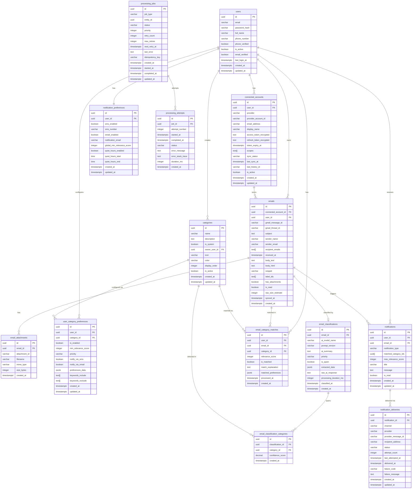

# InboxIQ — Database Architecture

> **Stack:** PostgreSQL 15+ · UUID primary keys · TIMESTAMPTZ · JSONB · Flyway migrations
> **Rule:** No `spring.jpa.hibernate.ddl-auto=update` — all schema changes go through versioned Flyway migrations.

---

## Table of Contents

1. [Database Overview](#1-database-overview)
2. [Entity Relationship Diagram](#2-entity-relationship-diagram)
3. [Complete Table Definitions](#3-complete-table-definitions)
4. [Database Relationships Summary](#4-database-relationships-summary-table)
5. [Critical Constraints and Rules](#5-critical-constraints-and-rules)
6. [Important Indexes and Query Patterns](#6-important-indexes-and-query-patterns)
7. [Flyway Migration Strategy](#7-flyway-migration-strategy)
8. [Data Retention & Deletion](#8-data-retention--deletion)
9. [JSONB Usage Guide](#9-jsonb-usage-guide)

---

## 1. Database Overview

InboxIQ uses **PostgreSQL 15+** as its sole database. The schema is designed around the following principles:

| Principle | Detail |
|-----------|--------|
| **Primary Keys** | UUID (`gen_random_uuid()`) on every table — avoids sequential ID enumeration attacks and supports future horizontal sharding |
| **Timestamps** | All `created_at` / `updated_at` / event timestamps use `TIMESTAMPTZ` (UTC stored, timezone-aware) |
| **Flexible Config** | `JSONB` columns for category-specific preference structures, extracted AI data, and matched preference snapshots |
| **Schema Migrations** | Flyway with `spring.flyway.validate-on-migrate=true`; migrations are immutable once applied |
| **No DDL Auto** | `spring.jpa.hibernate.ddl-auto=none` — Hibernate only validates against the existing schema |
| **Encryption** | OAuth tokens stored encrypted (AES-256) at the application layer; never stored in plaintext |
| **Soft Deletes** | Users use `is_active` flag before hard deletion for compliance and audit trail retention |

The 14 tables are organized into five logical groups:

- **Identity & Auth:** `users`, `connected_accounts`
- **Email Storage:** `emails`, `email_attachments`
- **Classification:** `categories`, `user_category_preferences`, `email_classifications`, `email_classification_categories`, `email_category_matches`
- **Notifications:** `notifications`, `notification_deliveries`, `notification_preferences`
- **Async Processing:** `processing_jobs`, `processing_attempts`

---

## 2. Entity Relationship Diagram



---

## 3. Complete Table Definitions

### 3.1 `users`

**Purpose:** Core user accounts for InboxIQ application authentication. Each row represents one registered InboxIQ user.

| Column | Type | Nullable | Default | Description |
|--------|------|----------|---------|-------------|
| `id` | UUID | NO | `gen_random_uuid()` | Primary key |
| `email` | VARCHAR(255) | NO | — | User's login email (unique) |
| `password_hash` | VARCHAR(255) | NO | — | BCrypt hashed password |
| `full_name` | VARCHAR(255) | NO | — | Display name |
| `phone_number` | VARCHAR(20) | YES | NULL | Phone number for SMS notifications |
| `phone_verified` | BOOLEAN | NO | `false` | Whether phone OTP was verified |
| `is_active` | BOOLEAN | NO | `true` | Soft-delete flag |
| `email_verified` | BOOLEAN | NO | `false` | Whether email was verified |
| `last_login_at` | TIMESTAMPTZ | YES | NULL | Last successful login timestamp |
| `created_at` | TIMESTAMPTZ | NO | `NOW()` | Record creation time |
| `updated_at` | TIMESTAMPTZ | NO | `NOW()` | Last modification time |

**Primary Key:** `id`

**Unique Constraints:**
- `UNIQUE (email)`

**Indexes:**

```sql
CREATE UNIQUE INDEX idx_users_email ON users(email);
```

> Used for login lookups and duplicate registration prevention.

---

### 3.2 `connected_accounts`

**Purpose:** Gmail accounts connected by users via Google OAuth 2.0. One user may connect multiple Gmail accounts.

| Column | Type | Nullable | Default | Description |
|--------|------|----------|---------|-------------|
| `id` | UUID | NO | `gen_random_uuid()` | Primary key |
| `user_id` | UUID | NO | — | FK → `users(id)` |
| `provider` | VARCHAR(50) | NO | `'GOOGLE'` | OAuth provider (`GOOGLE`) |
| `provider_account_id` | VARCHAR(255) | NO | — | Google `sub` (unique account ID) |
| `email_address` | VARCHAR(255) | NO | — | The Gmail address of this account |
| `display_name` | VARCHAR(255) | YES | NULL | Display name from Google profile |
| `access_token_encrypted` | TEXT | YES | NULL | AES-256 encrypted access token |
| `refresh_token_encrypted` | TEXT | NO | — | AES-256 encrypted refresh token |
| `token_expiry_at` | TIMESTAMPTZ | YES | NULL | Access token expiry |
| `scopes` | TEXT[] | NO | `'{}'` | Granted OAuth scopes |
| `sync_status` | VARCHAR(50) | NO | `'IDLE'` | Enum: `IDLE`, `SYNCING`, `FAILED` |
| `last_sync_at` | TIMESTAMPTZ | YES | NULL | Timestamp of last successful sync |
| `last_history_id` | VARCHAR(100) | YES | NULL | Gmail History API cursor for incremental sync |
| `is_active` | BOOLEAN | NO | `true` | Whether account is active/connected |
| `created_at` | TIMESTAMPTZ | NO | `NOW()` | Record creation time |
| `updated_at` | TIMESTAMPTZ | NO | `NOW()` | Last modification time |

**Primary Key:** `id`

**Foreign Keys:**
- `user_id` → `users(id)` ON DELETE CASCADE

**Unique Constraints:**
- `UNIQUE (user_id, provider_account_id)` — prevents connecting the same Google account twice under one user

**Indexes:**

```sql
CREATE INDEX idx_connected_accounts_user_id ON connected_accounts(user_id);
CREATE INDEX idx_connected_accounts_provider_id ON connected_accounts(provider_account_id);
```

---

### 3.3 `emails`

**Purpose:** Email metadata and content stored after Gmail sync. This is the source of truth for all AI processing and classification.

| Column | Type | Nullable | Default | Description |
|--------|------|----------|---------|-------------|
| `id` | UUID | NO | `gen_random_uuid()` | Primary key |
| `connected_account_id` | UUID | NO | — | FK → `connected_accounts(id)` |
| `user_id` | UUID | NO | — | FK → `users(id)` (denormalized for query performance) |
| `gmail_message_id` | VARCHAR(255) | NO | — | Gmail's unique message ID |
| `gmail_thread_id` | VARCHAR(255) | YES | NULL | Gmail thread ID |
| `subject` | TEXT | YES | NULL | Email subject line |
| `sender_name` | VARCHAR(500) | YES | NULL | Display name of sender |
| `sender_email` | VARCHAR(500) | NO | — | Email address of sender |
| `recipient_emails` | TEXT[] | NO | `'{}'` | Array of recipient addresses |
| `received_at` | TIMESTAMPTZ | NO | — | When the email was received |
| `body_text` | TEXT | YES | NULL | Plain-text body (may be truncated) |
| `body_html` | TEXT | YES | NULL | HTML body (stored for reference) |
| `snippet` | VARCHAR(500) | YES | NULL | Gmail-provided preview snippet |
| `label_ids` | TEXT[] | NO | `'{}'` | Gmail label IDs (e.g., INBOX, UNREAD) |
| `has_attachments` | BOOLEAN | NO | `false` | Whether email has attachments |
| `is_read` | BOOLEAN | NO | `false` | Read status |
| `raw_size_estimate` | INTEGER | YES | NULL | Estimated size in bytes |
| `synced_at` | TIMESTAMPTZ | NO | `NOW()` | When this record was synced |
| `created_at` | TIMESTAMPTZ | NO | `NOW()` | Record creation time |

**Primary Key:** `id`

**Foreign Keys:**
- `connected_account_id` → `connected_accounts(id)` ON DELETE CASCADE
- `user_id` → `users(id)` ON DELETE CASCADE

**Unique Constraints:**
- `UNIQUE (connected_account_id, gmail_message_id)` — **deduplication constraint**: prevents the same Gmail message from being stored twice for the same account

**Indexes:**

```sql
CREATE INDEX idx_emails_user_id ON emails(user_id);
CREATE INDEX idx_emails_connected_account_id ON emails(connected_account_id);
CREATE INDEX idx_emails_received_at ON emails(received_at DESC);
CREATE INDEX idx_emails_sender_email ON emails(sender_email);
CREATE INDEX idx_emails_gmail_message_id ON emails(gmail_message_id);
```

> `received_at DESC` ordering matches the typical inbox sort order and benefits pagination queries.

---

### 3.4 `email_attachments`

**Purpose:** Metadata for email attachments. Stores only the attachment descriptor, not the binary content itself.

| Column | Type | Nullable | Default | Description |
|--------|------|----------|---------|-------------|
| `id` | UUID | NO | `gen_random_uuid()` | Primary key |
| `email_id` | UUID | NO | — | FK → `emails(id)` |
| `attachment_id` | VARCHAR(255) | NO | — | Gmail attachment part ID |
| `filename` | VARCHAR(500) | YES | NULL | Original filename |
| `mime_type` | VARCHAR(255) | YES | NULL | MIME type (e.g., `application/pdf`) |
| `size_bytes` | INTEGER | YES | NULL | Attachment size in bytes |
| `created_at` | TIMESTAMPTZ | NO | `NOW()` | Record creation time |

**Primary Key:** `id`

**Foreign Keys:**
- `email_id` → `emails(id)` ON DELETE CASCADE

**Indexes:**

```sql
CREATE INDEX idx_email_attachments_email_id ON email_attachments(email_id);
```

---

### 3.5 `categories`

**Purpose:** Email categories — both built-in system categories and user-created custom categories. System categories are seeded via Flyway V15.

| Column | Type | Nullable | Default | Description |
|--------|------|----------|---------|-------------|
| `id` | UUID | NO | `gen_random_uuid()` | Primary key |
| `name` | VARCHAR(255) | NO | — | Category name |
| `description` | TEXT | YES | NULL | Human-readable description |
| `is_system` | BOOLEAN | NO | `false` | `true` = built-in, `false` = user-created |
| `owner_user_id` | UUID | YES | NULL | FK → `users(id)`; NULL for system categories |
| `icon` | VARCHAR(100) | YES | NULL | Icon identifier |
| `color` | VARCHAR(50) | YES | NULL | Hex color code |
| `display_order` | INTEGER | NO | `0` | UI display order |
| `is_active` | BOOLEAN | NO | `true` | Whether category is active |
| `created_at` | TIMESTAMPTZ | NO | `NOW()` | Record creation time |
| `updated_at` | TIMESTAMPTZ | NO | `NOW()` | Last modification time |

**Primary Key:** `id`

**Foreign Keys:**
- `owner_user_id` → `users(id)` ON DELETE CASCADE (nullable)

**Unique Constraints:**
- `UNIQUE (name, owner_user_id) WHERE owner_user_id IS NOT NULL` — partial unique index; prevents a user from creating two custom categories with the same name

**Check Constraints:**

```sql
CONSTRAINT chk_category_ownership
  CHECK (
    (is_system = true  AND owner_user_id IS NULL) OR
    (is_system = false AND owner_user_id IS NOT NULL)
  )
```

> Enforces the invariant: system categories have no owner; custom categories always have one.

**Indexes:**

```sql
CREATE INDEX idx_categories_owner_user_id ON categories(owner_user_id);
CREATE INDEX idx_categories_is_system ON categories(is_system);
```

**Built-in System Categories (seeded in V15):**

| # | Name |
|---|------|
| 1 | Career & Jobs |
| 2 | Creator & Brand Promotions |
| 3 | Sports |
| 4 | Education |
| 5 | Finance & Banking |
| 6 | Shopping & Offers |
| 7 | Events & Invitations |
| 8 | News & Updates |
| 9 | Technology & Product Updates |
| 10 | Travel & Bookings |
| 11 | Personal & Important Communications |

---

### 3.6 `user_category_preferences`

**Purpose:** Per-user configuration for each category they have enabled. Controls relevance thresholds, notification channels, and category-specific filter keywords.

| Column | Type | Nullable | Default | Description |
|--------|------|----------|---------|-------------|
| `id` | UUID | NO | `gen_random_uuid()` | Primary key |
| `user_id` | UUID | NO | — | FK → `users(id)` |
| `category_id` | UUID | NO | — | FK → `categories(id)` |
| `is_enabled` | BOOLEAN | NO | `true` | Whether this category is active for the user |
| `min_relevance_score` | INTEGER | NO | `60` | Minimum score (0–100) to trigger a notification |
| `priority` | VARCHAR(20) | NO | `'MEDIUM'` | Enum: `LOW`, `MEDIUM`, `HIGH` |
| `notify_via_sms` | BOOLEAN | NO | `true` | Send SMS for matches in this category |
| `notify_via_email` | BOOLEAN | NO | `false` | Send email for matches in this category |
| `preferences_data` | JSONB | YES | NULL | Category-specific filter config (see Section 9) |
| `keywords_include` | TEXT[] | NO | `'{}'` | Required keywords for a match |
| `keywords_exclude` | TEXT[] | NO | `'{}'` | Keywords that disqualify a match |
| `created_at` | TIMESTAMPTZ | NO | `NOW()` | Record creation time |
| `updated_at` | TIMESTAMPTZ | NO | `NOW()` | Last modification time |

**Primary Key:** `id`

**Foreign Keys:**
- `user_id` → `users(id)` ON DELETE CASCADE
- `category_id` → `categories(id)` ON DELETE CASCADE

**Unique Constraints:**
- `UNIQUE (user_id, category_id)` — one preference row per user per category

**Check Constraints:**

```sql
CONSTRAINT chk_min_relevance_score
  CHECK (min_relevance_score BETWEEN 0 AND 100)
```

**Indexes:**

```sql
CREATE INDEX idx_user_category_pref_user_id ON user_category_preferences(user_id);
CREATE INDEX idx_user_category_pref_category_id ON user_category_preferences(category_id);
```

---

### 3.7 `email_classifications`

**Purpose:** Global AI classification result for each email. One row per email, shared across all users. Reused when the same email matches multiple users' preferences, avoiding redundant AI calls.

| Column | Type | Nullable | Default | Description |
|--------|------|----------|---------|-------------|
| `id` | UUID | NO | `gen_random_uuid()` | Primary key |
| `email_id` | UUID | NO | — | FK → `emails(id)` (unique: 1-to-1) |
| `ai_model_name` | VARCHAR(255) | NO | — | Model used (e.g., `gemini-1.5-flash`) |
| `prompt_version` | VARCHAR(50) | NO | — | Prompt template version (e.g., `v1.0`) |
| `ai_summary` | TEXT | YES | NULL | AI-generated summary of the email |
| `priority` | VARCHAR(20) | YES | NULL | AI-assessed priority: `HIGH`, `MEDIUM`, `LOW` |
| `is_spam` | BOOLEAN | NO | `false` | Whether AI flagged email as spam |
| `extracted_data` | JSONB | YES | NULL | Structured extraction (job title, event date, etc.) |
| `raw_ai_response` | TEXT | YES | NULL | Full AI response (masked in production logs) |
| `processing_duration_ms` | INTEGER | YES | NULL | Classification latency in milliseconds |
| `classified_at` | TIMESTAMPTZ | NO | `NOW()` | When classification completed |
| `created_at` | TIMESTAMPTZ | NO | `NOW()` | Record creation time |

**Primary Key:** `id`

**Foreign Keys:**
- `email_id` → `emails(id)` ON DELETE CASCADE

**Unique Constraints:**
- `UNIQUE (email_id)` — enforces one classification per email

**Indexes:**

```sql
CREATE INDEX idx_email_classifications_email_id ON email_classifications(email_id);
```

---

### 3.8 `email_classification_categories`

**Purpose:** Junction table linking a global classification result to its detected system categories with AI confidence scores. One row per (classification, category) pair.

| Column | Type | Nullable | Default | Description |
|--------|------|----------|---------|-------------|
| `id` | UUID | NO | `gen_random_uuid()` | Primary key |
| `classification_id` | UUID | NO | — | FK → `email_classifications(id)` |
| `category_id` | UUID | NO | — | FK → `categories(id)` (system categories only) |
| `confidence_score` | DECIMAL(5,4) | NO | — | AI confidence (0.0000–1.0000) |
| `created_at` | TIMESTAMPTZ | NO | `NOW()` | Record creation time |

**Primary Key:** `id`

**Foreign Keys:**
- `classification_id` → `email_classifications(id)` ON DELETE CASCADE
- `category_id` → `categories(id)` ON DELETE RESTRICT

**Unique Constraints:**
- `UNIQUE (classification_id, category_id)`

**Check Constraints:**

```sql
CONSTRAINT chk_confidence_score
  CHECK (confidence_score BETWEEN 0 AND 1)
```

**Indexes:**

```sql
CREATE INDEX idx_email_class_categories_classification_id ON email_classification_categories(classification_id);
CREATE INDEX idx_email_class_categories_category_id ON email_classification_categories(category_id);
```

---

### 3.9 `email_category_matches`

**Purpose:** User-specific relevance matching result. After a global classification, this table records whether the email matched each user's configured preferences for each category.

| Column | Type | Nullable | Default | Description |
|--------|------|----------|---------|-------------|
| `id` | UUID | NO | `gen_random_uuid()` | Primary key |
| `user_id` | UUID | NO | — | FK → `users(id)` |
| `email_id` | UUID | NO | — | FK → `emails(id)` |
| `category_id` | UUID | NO | — | FK → `categories(id)` (system or custom) |
| `relevance_score` | INTEGER | NO | — | 0–100 relevance score for this user |
| `is_matched` | BOOLEAN | NO | `false` | Whether the score met the user's threshold |
| `match_explanation` | TEXT | YES | NULL | Human-readable explanation of match result |
| `matched_preferences` | JSONB | YES | NULL | Snapshot of which preference fields triggered |
| `processed_at` | TIMESTAMPTZ | NO | `NOW()` | When match evaluation ran |
| `created_at` | TIMESTAMPTZ | NO | `NOW()` | Record creation time |

**Primary Key:** `id`

**Foreign Keys:**
- `user_id` → `users(id)` ON DELETE CASCADE
- `email_id` → `emails(id)` ON DELETE CASCADE
- `category_id` → `categories(id)` ON DELETE CASCADE

**Unique Constraints:**
- `UNIQUE (user_id, email_id, category_id)` — one result per user-email-category combination

**Check Constraints:**

```sql
CONSTRAINT chk_relevance_score
  CHECK (relevance_score BETWEEN 0 AND 100)
```

**Indexes:**

```sql
CREATE INDEX idx_email_category_matches_user_email ON email_category_matches(user_id, email_id);
CREATE INDEX idx_email_category_matches_user_id ON email_category_matches(user_id);
CREATE INDEX idx_email_category_matches_matched ON email_category_matches(user_id, is_matched);
```

---

### 3.10 `notifications`

**Purpose:** One notification event per email per user, even when multiple categories matched. Aggregates all matched category IDs into a single record.

| Column | Type | Nullable | Default | Description |
|--------|------|----------|---------|-------------|
| `id` | UUID | NO | `gen_random_uuid()` | Primary key |
| `user_id` | UUID | NO | — | FK → `users(id)` |
| `email_id` | UUID | NO | — | FK → `emails(id)` |
| `notification_type` | VARCHAR(50) | NO | `'EMAIL_MATCH'` | Type of event |
| `matched_category_ids` | UUID[] | NO | `'{}'` | All category IDs that triggered this notification |
| `max_relevance_score` | INTEGER | NO | — | Highest relevance score among all matches |
| `title` | VARCHAR(500) | NO | — | Notification title shown to user |
| `message` | TEXT | NO | — | Notification body text |
| `is_read` | BOOLEAN | NO | `false` | Whether user has read this notification |
| `created_at` | TIMESTAMPTZ | NO | `NOW()` | Record creation time |
| `updated_at` | TIMESTAMPTZ | NO | `NOW()` | Last modification time |

**Primary Key:** `id`

**Foreign Keys:**
- `user_id` → `users(id)` ON DELETE CASCADE
- `email_id` → `emails(id)` ON DELETE CASCADE

**Unique Constraints:**
- `UNIQUE (user_id, email_id)` — **deduplication constraint**: only one notification per user per email regardless of how many categories matched

**Check Constraints:**

```sql
CONSTRAINT chk_max_relevance_score
  CHECK (max_relevance_score BETWEEN 0 AND 100)
```

**Indexes:**

```sql
CREATE INDEX idx_notifications_user_id ON notifications(user_id);
CREATE INDEX idx_notifications_user_email ON notifications(user_id, email_id);
CREATE INDEX idx_notifications_created_at ON notifications(created_at DESC);
```

---

### 3.11 `notification_deliveries`

**Purpose:** Per-channel delivery tracking for each notification event. One row per channel (SMS, EMAIL) used for a given notification.

| Column | Type | Nullable | Default | Description |
|--------|------|----------|---------|-------------|
| `id` | UUID | NO | `gen_random_uuid()` | Primary key |
| `notification_id` | UUID | NO | — | FK → `notifications(id)` |
| `channel` | VARCHAR(50) | NO | — | Delivery channel: `SMS`, `EMAIL`, `WHATSAPP`, `PUSH` |
| `provider` | VARCHAR(100) | NO | — | Provider name: `TWILIO`, `MSG91`, etc. |
| `provider_message_id` | VARCHAR(500) | YES | NULL | Provider's message/delivery ID |
| `recipient_address` | VARCHAR(500) | NO | — | Phone number or email address |
| `status` | VARCHAR(50) | NO | `'PENDING'` | `PENDING`, `SENT`, `DELIVERED`, `FAILED` |
| `attempt_count` | INTEGER | NO | `0` | Number of delivery attempts made |
| `last_attempted_at` | TIMESTAMPTZ | YES | NULL | Timestamp of most recent attempt |
| `delivered_at` | TIMESTAMPTZ | YES | NULL | Timestamp of confirmed delivery |
| `failure_code` | VARCHAR(100) | YES | NULL | Provider error code on failure |
| `failure_message` | TEXT | YES | NULL | Human-readable failure reason |
| `created_at` | TIMESTAMPTZ | NO | `NOW()` | Record creation time |
| `updated_at` | TIMESTAMPTZ | NO | `NOW()` | Last modification time |

**Primary Key:** `id`

**Foreign Keys:**
- `notification_id` → `notifications(id)` ON DELETE CASCADE

**Unique Constraints:**
- `UNIQUE (notification_id, channel)` — one delivery record per channel per notification

**Indexes:**

```sql
CREATE INDEX idx_notification_deliveries_notification_id ON notification_deliveries(notification_id);
CREATE INDEX idx_notification_deliveries_status ON notification_deliveries(status);
```

---

### 3.12 `notification_preferences`

**Purpose:** User-level channel and filter preferences for notifications. Controls global thresholds and quiet-hour windows. One row per user.

| Column | Type | Nullable | Default | Description |
|--------|------|----------|---------|-------------|
| `id` | UUID | NO | `gen_random_uuid()` | Primary key |
| `user_id` | UUID | NO | — | FK → `users(id)` (unique: 1-to-1) |
| `sms_enabled` | BOOLEAN | NO | `false` | Whether SMS notifications are active |
| `sms_number` | VARCHAR(20) | YES | NULL | Phone number for SMS delivery |
| `email_enabled` | BOOLEAN | NO | `false` | Whether email notifications are active |
| `notification_email` | VARCHAR(255) | YES | NULL | Email address for notification delivery |
| `global_min_relevance_score` | INTEGER | NO | `60` | Global threshold (0–100); overridden by per-category settings |
| `quiet_hours_enabled` | BOOLEAN | NO | `false` | Whether to suppress notifications during quiet hours |
| `quiet_hours_start` | TIME | YES | NULL | Quiet period start (e.g., `22:00`) |
| `quiet_hours_end` | TIME | YES | NULL | Quiet period end (e.g., `07:00`) |
| `created_at` | TIMESTAMPTZ | NO | `NOW()` | Record creation time |
| `updated_at` | TIMESTAMPTZ | NO | `NOW()` | Last modification time |

**Primary Key:** `id`

**Foreign Keys:**
- `user_id` → `users(id)` ON DELETE CASCADE

**Unique Constraints:**
- `UNIQUE (user_id)` — one preferences row per user (1-to-1 with `users`)

**Check Constraints:**

```sql
CONSTRAINT chk_global_min_relevance_score
  CHECK (global_min_relevance_score BETWEEN 0 AND 100)
```

---

### 3.13 `processing_jobs`

**Purpose:** Persistent job queue for async email processing. Each row is a unit of work (typically one email to classify). Survives application restarts; supports retries and dead-letter semantics.

| Column | Type | Nullable | Default | Description |
|--------|------|----------|---------|-------------|
| `id` | UUID | NO | `gen_random_uuid()` | Primary key |
| `job_type` | VARCHAR(100) | NO | `'EMAIL_CLASSIFICATION'` | Type of job (extensible) |
| `entity_id` | UUID | NO | — | The email ID (or other entity) being processed |
| `status` | VARCHAR(50) | NO | `'PENDING'` | `PENDING`, `PROCESSING`, `RETRY_WAIT`, `COMPLETED`, `DEAD` |
| `priority` | INTEGER | NO | `5` | 1 = highest priority, 10 = lowest |
| `retry_count` | INTEGER | NO | `0` | Number of retries performed |
| `max_retries` | INTEGER | NO | `5` | Maximum retries before marking DEAD |
| `next_retry_at` | TIMESTAMPTZ | NO | `NOW()` | When the job is eligible to be picked up next |
| `last_error` | TEXT | YES | NULL | Most recent error message |
| `idempotency_key` | VARCHAR(500) | NO | — | Unique key (e.g., `EMAIL_CLASSIFICATION:email-uuid`) |
| `created_at` | TIMESTAMPTZ | NO | `NOW()` | Record creation time |
| `started_at` | TIMESTAMPTZ | YES | NULL | When a worker last picked up this job |
| `completed_at` | TIMESTAMPTZ | YES | NULL | When the job reached terminal state |
| `updated_at` | TIMESTAMPTZ | NO | `NOW()` | Last modification time |

**Primary Key:** `id`

**Unique Constraints:**
- `UNIQUE (idempotency_key)` — prevents duplicate job creation for the same email

**Check Constraints:**

```sql
CONSTRAINT chk_job_status
  CHECK (status IN ('PENDING', 'PROCESSING', 'RETRY_WAIT', 'COMPLETED', 'DEAD'))
```

**Indexes:**

```sql
-- Critical: used by the dispatcher poll query
CREATE INDEX idx_processing_jobs_status_retry
  ON processing_jobs(status, next_retry_at);

CREATE INDEX idx_processing_jobs_entity_id
  ON processing_jobs(entity_id);

CREATE UNIQUE INDEX idx_processing_jobs_idempotency_key
  ON processing_jobs(idempotency_key);
```

---

### 3.14 `processing_attempts`

**Purpose:** Immutable history of each individual attempt to process a job. Never updated — only inserted. Preserved for debugging and observability.

| Column | Type | Nullable | Default | Description |
|--------|------|----------|---------|-------------|
| `id` | UUID | NO | `gen_random_uuid()` | Primary key |
| `job_id` | UUID | NO | — | FK → `processing_jobs(id)` |
| `attempt_number` | INTEGER | NO | — | 1-based attempt counter |
| `started_at` | TIMESTAMPTZ | NO | `NOW()` | When this attempt began |
| `completed_at` | TIMESTAMPTZ | YES | NULL | When this attempt ended |
| `status` | VARCHAR(50) | NO | — | `SUCCESS`, `FAILED`, `TIMEOUT` |
| `error_message` | TEXT | YES | NULL | Error message if failed |
| `error_stack_trace` | TEXT | YES | NULL | Full stack trace (dev/staging only) |
| `duration_ms` | INTEGER | YES | NULL | Attempt duration in milliseconds |
| `created_at` | TIMESTAMPTZ | NO | `NOW()` | Record creation time |

**Primary Key:** `id`

**Foreign Keys:**
- `job_id` → `processing_jobs(id)` ON DELETE CASCADE

**Unique Constraints:**
- `UNIQUE (job_id, attempt_number)` — ensures attempt numbers are non-duplicated per job

**Indexes:**

```sql
CREATE INDEX idx_processing_attempts_job_id ON processing_attempts(job_id);
```

---

## 4. Database Relationships Summary Table

| Child Table | FK Column | References | On Delete |
|-------------|-----------|------------|-----------|
| `connected_accounts` | `user_id` | `users(id)` | CASCADE |
| `emails` | `connected_account_id` | `connected_accounts(id)` | CASCADE |
| `emails` | `user_id` | `users(id)` | CASCADE |
| `email_attachments` | `email_id` | `emails(id)` | CASCADE |
| `categories` | `owner_user_id` | `users(id)` | CASCADE |
| `user_category_preferences` | `user_id` | `users(id)` | CASCADE |
| `user_category_preferences` | `category_id` | `categories(id)` | CASCADE |
| `email_classifications` | `email_id` | `emails(id)` | CASCADE |
| `email_classification_categories` | `classification_id` | `email_classifications(id)` | CASCADE |
| `email_classification_categories` | `category_id` | `categories(id)` | RESTRICT |
| `email_category_matches` | `user_id` | `users(id)` | CASCADE |
| `email_category_matches` | `email_id` | `emails(id)` | CASCADE |
| `email_category_matches` | `category_id` | `categories(id)` | CASCADE |
| `notifications` | `user_id` | `users(id)` | CASCADE |
| `notifications` | `email_id` | `emails(id)` | CASCADE |
| `notification_deliveries` | `notification_id` | `notifications(id)` | CASCADE |
| `notification_preferences` | `user_id` | `users(id)` | CASCADE |
| `processing_attempts` | `job_id` | `processing_jobs(id)` | CASCADE |

> **Note on RESTRICT:** `email_classification_categories.category_id` uses ON DELETE RESTRICT to prevent accidental deletion of a system category that has existing classification data. System categories should only be deactivated (`is_active = false`), never hard-deleted.

---

## 5. Critical Constraints and Rules

### 5.1 Duplicate Gmail Message Prevention

```sql
ALTER TABLE emails
  ADD CONSTRAINT uq_emails_account_message
  UNIQUE (connected_account_id, gmail_message_id);
```

**Why:** Gmail sync may run repeatedly (webhook + polling fallback). Without this constraint, the same email could be inserted multiple times if two sync threads race. The `ON CONFLICT DO NOTHING` or `ON CONFLICT DO UPDATE` upsert pattern relies on this constraint being present.

---

### 5.2 Duplicate Notification Prevention

```sql
ALTER TABLE notifications
  ADD CONSTRAINT uq_notifications_user_email
  UNIQUE (user_id, email_id);
```

**Why:** Even if 3 categories match for a user on a single email, only one notification event should be created. The application uses `INSERT ... ON CONFLICT (user_id, email_id) DO UPDATE SET matched_category_ids = ...` to merge category IDs into the existing record rather than creating duplicates.

---

### 5.3 Duplicate Job Prevention

```sql
ALTER TABLE processing_jobs
  ADD CONSTRAINT uq_processing_jobs_idempotency_key
  UNIQUE (idempotency_key);
```

**Why:** The `idempotency_key` is composed as `{job_type}:{entity_id}` (e.g., `EMAIL_CLASSIFICATION:550e8400-e29b-41d4-a716-446655440000`). When a Gmail webhook fires multiple times for the same message, the second `INSERT` will violate this constraint and be safely discarded.

---

### 5.4 Category Ownership Invariant

```sql
ALTER TABLE categories
  ADD CONSTRAINT chk_category_ownership
  CHECK (
    (is_system = true  AND owner_user_id IS NULL) OR
    (is_system = false AND owner_user_id IS NOT NULL)
  );
```

**Why:** Prevents inconsistent states such as a "system" category with an owner, or a "custom" category with no owner. This invariant is critical for the AI prompt-building logic that decides which categories to pass to the model.

---

### 5.5 Relevance Score Bounds

```sql
-- On email_category_matches
ALTER TABLE email_category_matches
  ADD CONSTRAINT chk_relevance_score
  CHECK (relevance_score BETWEEN 0 AND 100);

-- On notification_preferences
ALTER TABLE notification_preferences
  ADD CONSTRAINT chk_global_min_relevance_score
  CHECK (global_min_relevance_score BETWEEN 0 AND 100);

-- On user_category_preferences
ALTER TABLE user_category_preferences
  ADD CONSTRAINT chk_min_relevance_score
  CHECK (min_relevance_score BETWEEN 0 AND 100);
```

**Why:** Relevance scores are computed as integers 0–100 (percentage-like). These constraints prevent AI output bugs from persisting garbage values to the database.

---

### 5.6 Confidence Score Bounds

```sql
ALTER TABLE email_classification_categories
  ADD CONSTRAINT chk_confidence_score
  CHECK (confidence_score BETWEEN 0 AND 1);
```

**Why:** Confidence scores are raw AI probability outputs in [0, 1]. The `DECIMAL(5,4)` type gives four decimal places of precision (e.g., `0.9875`). The check constraint guards against values outside the probability range.

---

## 6. Important Indexes and Query Patterns

### 6.1 Job Dispatcher Query — Most Critical Index

The processing engine polls for work using this query:

```sql
SELECT *
FROM processing_jobs
WHERE status IN ('PENDING', 'RETRY_WAIT')
  AND next_retry_at <= NOW()
ORDER BY priority ASC, created_at ASC
FOR UPDATE SKIP LOCKED
LIMIT 10;
```

**Required index:**

```sql
CREATE INDEX idx_processing_jobs_status_retry
  ON processing_jobs(status, next_retry_at);
```

**Why this index:** The WHERE clause filters on `status` (low cardinality) and `next_retry_at` (time-based). The composite index allows PostgreSQL to scan only eligible jobs without a full-table scan. `FOR UPDATE SKIP LOCKED` enables multiple dispatcher threads to work concurrently without blocking each other.

---

### 6.2 User Inbox Listing

```sql
SELECT e.*
FROM emails e
WHERE e.user_id = $1
ORDER BY e.received_at DESC
LIMIT 20 OFFSET $2;
```

**Required indexes:**

```sql
CREATE INDEX idx_emails_user_id ON emails(user_id);
CREATE INDEX idx_emails_received_at ON emails(received_at DESC);
```

**Why:** `user_id` narrows the row set to one user's emails. `received_at DESC` matches the ORDER BY direction, enabling an index scan without a sort step. For optimal performance, consider a composite index `(user_id, received_at DESC)`.

---

### 6.3 User Matched Emails (Notification Feed)

```sql
SELECT ecm.*
FROM email_category_matches ecm
WHERE ecm.user_id = $1
  AND ecm.is_matched = true
ORDER BY ecm.processed_at DESC;
```

**Required index:**

```sql
CREATE INDEX idx_email_category_matches_matched
  ON email_category_matches(user_id, is_matched);
```

**Why:** This query powers the "matched emails" feed — the core InboxIQ feature. The composite `(user_id, is_matched)` index allows PostgreSQL to filter to matched rows for a specific user efficiently.

---

### 6.4 Unread Notifications for User

```sql
SELECT n.*
FROM notifications n
WHERE n.user_id = $1
  AND n.is_read = false
ORDER BY n.created_at DESC;
```

**Served by:** `idx_notifications_user_id` + `idx_notifications_created_at`

---

### 6.5 Delivery Status Check (Retry Logic)

```sql
SELECT nd.*
FROM notification_deliveries nd
WHERE nd.status IN ('PENDING', 'FAILED')
  AND nd.attempt_count < 3;
```

**Served by:** `idx_notification_deliveries_status`

---

## 7. Flyway Migration Strategy

### Naming Convention

```
V{version}__{description}.sql
```

- Version is a monotonically increasing integer
- Two underscores between version and description
- Description uses underscores (no spaces)

**Examples:**
```
V1__create_users_table.sql
V15__seed_system_categories.sql
V16__add_whatsapp_channel_support.sql
```

### Migration Order

| Version | File | Purpose |
|---------|------|---------|
| V1 | `V1__create_users_table.sql` | Foundation: `users` |
| V2 | `V2__create_connected_accounts_table.sql` | OAuth accounts |
| V3 | `V3__create_emails_table.sql` | Email storage |
| V4 | `V4__create_email_attachments_table.sql` | Attachment metadata |
| V5 | `V5__create_categories_table.sql` | Category definitions |
| V6 | `V6__create_user_category_preferences_table.sql` | User-category config |
| V7 | `V7__create_email_classifications_table.sql` | AI classification results |
| V8 | `V8__create_email_classification_categories_table.sql` | Classification-category junction |
| V9 | `V9__create_email_category_matches_table.sql` | Per-user match results |
| V10 | `V10__create_notifications_table.sql` | Notification events |
| V11 | `V11__create_notification_deliveries_table.sql` | Delivery tracking |
| V12 | `V12__create_notification_preferences_table.sql` | User notification settings |
| V13 | `V13__create_processing_jobs_table.sql` | Async job queue |
| V14 | `V14__create_processing_attempts_table.sql` | Job attempt history |
| V15 | `V15__seed_system_categories.sql` | Insert 11 built-in categories |

### Key Rules

1. **Never modify an applied migration.** Flyway checksums every file; changing a previously run migration will break startup with a `FlywayException`.
2. **Always create new migration files for schema changes.** Additive changes (new column, new index) go in a new `V{n+1}__...sql` file.
3. **Validation on startup:** `spring.flyway.validate-on-migrate=true` ensures the applied migration history matches the files on disk before the application starts.
4. **Repeatable migrations** (`R__`) may be used for views or seed data that changes, but use with care — they re-run on every checksum change.
5. **Out-of-order protection:** `spring.flyway.out-of-order=false` (default) prevents V3 from being applied after V5 is already in the database.

### Spring Boot Configuration

```yaml
spring:
  flyway:
    enabled: true
    locations: classpath:db/migration
    validate-on-migrate: true
    out-of-order: false
  jpa:
    hibernate:
      ddl-auto: none   # Flyway owns the schema; Hibernate only validates
```

---

## 8. Data Retention & Deletion

### Cascade Delete Tree

```
users (hard delete)
├── connected_accounts         [CASCADE]
│   └── emails                 [CASCADE]
│       ├── email_attachments  [CASCADE]
│       ├── email_classifications [CASCADE]
│       │   └── email_classification_categories [CASCADE]
│       ├── email_category_matches [CASCADE]
│       └── notifications      [CASCADE]
│           └── notification_deliveries [CASCADE]
├── emails (direct FK)         [CASCADE]
├── email_category_matches     [CASCADE]
├── notifications              [CASCADE]
├── notification_preferences   [CASCADE]
├── user_category_preferences  [CASCADE]
└── categories (custom)        [CASCADE]
```

### Deletion Scenarios

| Trigger | Cascades To |
|---------|-------------|
| User deleted | `connected_accounts`, `emails` (via user_id FK), `email_category_matches`, `notifications`, `notification_deliveries` (via notifications), `notification_preferences`, `user_category_preferences`, custom `categories` |
| Connected account disconnected | `emails` for that account (and their downstream: `email_attachments`, `email_classifications`, `email_category_matches`, `notifications`) |
| Email deleted | `email_attachments`, `email_classifications` → `email_classification_categories`, `email_category_matches`, `notifications` → `notification_deliveries` |
| Notification deleted | `notification_deliveries` |
| Processing job deleted | `processing_attempts` |

### Recommended Soft Delete Flow

> [!IMPORTANT]
> Hard-deleting a user immediately cascades to all associated data with no recovery path. Follow this safer sequence:

1. **Step 1 — Soft delete:** Set `users.is_active = false`. Application login is blocked; data is preserved.
2. **Step 2 — Revoke OAuth tokens:** Call Google's token revocation endpoint and clear `refresh_token_encrypted` from `connected_accounts`.
3. **Step 3 — Retention window:** Hold data for 30 days (or as required by your data retention policy / GDPR right-to-erasure timeline).
4. **Step 4 — Hard delete:** Issue `DELETE FROM users WHERE id = $1`. All downstream rows cascade automatically.

> [!WARNING]
> `email_classification_categories.category_id` is ON DELETE RESTRICT. System categories (`is_system = true`) must **never** be hard-deleted; set `is_active = false` instead. Attempting to delete a system category that has linked classification data will raise a `ForeignKeyViolationException`.

---

## 9. JSONB Usage Guide

JSONB columns provide schema flexibility for data whose structure varies by category or by AI model version, without requiring DDL changes.

### `user_category_preferences.preferences_data`

This column holds category-specific filter configuration supplied by the user. The structure differs per category type:

```json
// Career & Jobs
{
  "jobRoles": ["Java Developer", "Backend Engineer"],
  "locations": ["Bangalore", "Remote"],
  "experienceLevel": "Fresher",
  "graduationBatch": "2024",
  "skills": ["Java", "Spring Boot", "PostgreSQL"],
  "excludedRoles": ["PHP Developer"]
}
```

```json
// Creator & Brand Promotions
{
  "niche": ["Technology", "Programming"],
  "platforms": ["YouTube", "Instagram"],
  "collaborationTypes": ["Sponsored Post", "Product Review"],
  "brandCategories": ["SaaS", "Developer Tools"]
}
```

```json
// Sports
{
  "sports": ["Cricket", "Football"],
  "teams": ["India", "Chennai Super Kings"],
  "tournaments": ["IPL", "World Cup"]
}
```

```json
// Education
{
  "subjects": ["Computer Science", "AI/ML"],
  "courses": ["Spring Boot", "System Design"],
  "institutions": ["IIT", "Coursera"],
  "certifications": ["AWS", "Google Cloud"]
}
```

```json
// Finance & Banking
{
  "alertTypes": ["Transaction Alert", "Statement Ready", "Fraud Alert"],
  "banks": ["HDFC", "SBI"],
  "amountThreshold": 10000
}
```

```json
// Travel & Bookings
{
  "transportTypes": ["Flight", "Train"],
  "airlines": ["IndiGo", "Air India"],
  "hotels": ["OYO", "Marriott"],
  "travelApps": ["MakeMyTrip", "Cleartrip"]
}
```

---

### `email_classifications.extracted_data`

Structured data extracted from the email body by the AI model. Schema varies by the detected category:

```json
// Career & Jobs email extraction
{
  "jobTitle": "Senior Java Developer",
  "company": "Infosys",
  "location": "Bangalore",
  "salary": "18-22 LPA",
  "applyDeadline": "2024-12-31",
  "skills": ["Java", "Spring Boot", "Microservices"]
}
```

```json
// Finance email extraction
{
  "transactionAmount": 5000.00,
  "transactionType": "Debit",
  "merchantName": "Amazon",
  "accountLast4": "4321",
  "transactionDate": "2024-11-13"
}
```

---

### `email_category_matches.matched_preferences`

A snapshot of which preference fields contributed to the match, stored for auditability and UI display:

```json
{
  "matchedJobRoles": ["Java Developer"],
  "matchedLocations": ["Bangalore"],
  "matchedSkills": ["Spring Boot"],
  "keywordMatches": ["hiring", "urgent"],
  "confidenceScore": 0.92,
  "explanationTokens": ["role match", "location match", "skill alignment"]
}
```

---

### JSONB Querying Examples

```sql
-- Find users who want Java Developer roles in Bangalore
SELECT ucp.user_id
FROM user_category_preferences ucp
JOIN categories c ON c.id = ucp.category_id
WHERE c.name = 'Career & Jobs'
  AND ucp.preferences_data @> '{"jobRoles": ["Java Developer"]}'::jsonb
  AND ucp.preferences_data @> '{"locations": ["Bangalore"]}'::jsonb;

-- Find classifications where extracted job title matches
SELECT ec.email_id, ec.extracted_data->>'jobTitle' AS job_title
FROM email_classifications ec
WHERE ec.extracted_data ? 'jobTitle'
  AND ec.extracted_data->>'jobTitle' ILIKE '%Java%';
```

> [!TIP]
> Create GIN indexes on JSONB columns that are queried with `@>` (containment) or `?` (key existence) operators for large tables:
> ```sql
> CREATE INDEX idx_ucp_preferences_data ON user_category_preferences USING GIN (preferences_data);
> CREATE INDEX idx_ec_extracted_data ON email_classifications USING GIN (extracted_data);
> ```
