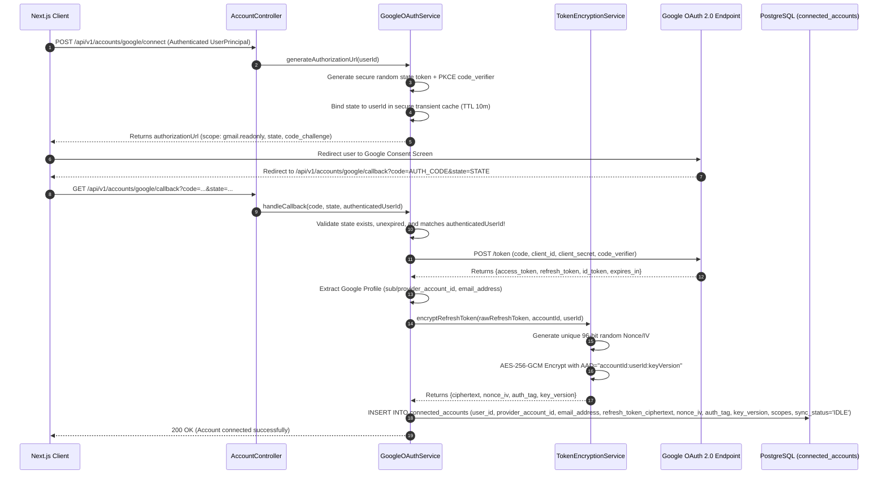
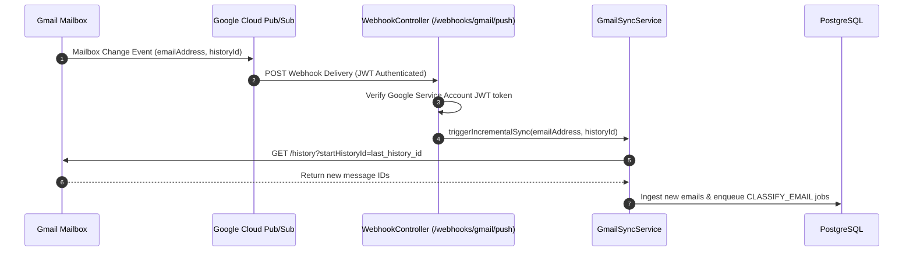

# InboxIQ – Gmail Integration Specification (GMAIL-INTEGRATION-v2.md)
**Google OAuth 2.0, Ingestion Pipeline & Synchronization Architecture**

---

## 1. Overview & Two-Stage Integration Strategy

InboxIQ integrates with Google Gmail strictly as a read-only intelligence layer. The integration is planned in two distinct phases:

### Phase 1: MVP (Scheduled & Incremental Polling)
- Connect Gmail mailboxes via **Google OAuth 2.0** using minimal read-only permissions (`gmail.readonly`).
- **Initial Sync:** Ingest the most recent 100 emails upon connection.
- **Manual Sync:** Users can trigger immediate on-demand synchronization from the settings dashboard.
- **Scheduled Polling:** A background cron job runs every 15 minutes per active connected account.
- **Incremental Sync:** Leverages the **Gmail History API** (`users.history.list`) using `last_history_id` checkpoints to fetch only new/modified messages.
- **Deduplication:** Enforced by PostgreSQL unique constraint: `UNIQUE (connected_account_id, gmail_message_id)`.

### Phase 2: Advanced (Gmail Cloud Pub/Sub Push Notifications - Post-MVP)
- Real-time mailbox change notifications via Google Cloud Pub/Sub.
- Daily scheduled renewal of the 7-day Gmail watch subscription (`POST /gmail/v1/users/me/watch`).
- Scheduled polling remains active as a resilient fallback.

---

## 2. Google OAuth 2.0 Architecture & Security

### 2.1 Least Privilege OAuth Scopes
InboxIQ strictly requests:
`https://www.googleapis.com/auth/gmail.readonly`
This scope allows reading message metadata, email headers, body content, and attachments. It **does not permit** composing, sending, modifying labels, or deleting user emails.

### 2.2 Detailed OAuth 2.0 Connection Sequence


---

## 3. Email Ingestion & Data Extraction

### 3.1 MIME Parsing & Extraction Pipeline
When messages are retrieved via `users.messages.get(format=FULL)`:
1. **Headers:** Extract `Subject`, `From`, `To`, `Date`, `Message-ID`.
2. **Body Text Extraction:**
   - Traverse MIME multi-part payload.
   - If `text/plain` part exists, decode from base64url and set as `body_text`.
   - If only `text/html` exists, run HTML sanitizer to extract plain text for `body_text` while retaining sanitized HTML in `body_html`.
3. **Snippet:** Capture Gmail preview snippet.
4. **Attachments:** Extract attachment metadata (`attachmentId`, `filename`, `mimeType`, `sizeBytes`) into `email_attachments`. Binary payloads are **not stored** in the MVP to minimize storage exposure and costs.

### 3.2 Deduplication Strategy
To prevent double processing:
```sql
INSERT INTO emails (
    connected_account_id, user_id, gmail_message_id, gmail_thread_id,
    subject, sender_name, sender_email, recipient_emails, received_at,
    body_text, snippet, label_ids, has_attachments, synced_at
)
VALUES (...)
ON CONFLICT (connected_account_id, gmail_message_id) DO NOTHING
RETURNING id;
```
If an email was already ingested in a previous cycle, `ON CONFLICT` prevents duplicate rows, returning `null`. No duplicate background job is enqueued.

---

## 4. Incremental Sync with Gmail History API

1. **Initial Sync Baseline:**
   - Retrieve the user profile: `GET /gmail/v1/users/me/profile`.
   - Store `historyId` in `connected_accounts.last_history_id`.
   - Fetch recent 100 messages via `GET /gmail/v1/users/me/messages?maxResults=100`.
2. **Incremental Cycles:**
   - Call `GET /gmail/v1/users/me/history?startHistoryId={last_history_id}`.
   - Iterate through `history.messagesAdded`.
   - Ingest each newly added message.
   - Update `connected_accounts.last_history_id` to the latest `historyId` returned.
3. **History Expired Fallback:**
   - Google expires History IDs if an account remains unsynced for several weeks.
   - If Gmail returns `404 History id not found`:
     - Catch `GoogleJsonResponseException`.
     - Log warning: `HISTORY_ID_EXPIRED`.
     - Gracefully fallback to date-based incremental sync: `GET /messages?q=after:{last_sync_timestamp}`.
     - Reset `last_history_id` to the current mailbox profile `historyId`.

---

## 5. Token Revocation & Disconnection Workflow (Correction 12)

When a user disconnects their Gmail account:
1. Update `connected_accounts.sync_status = 'DISCONNECTING'` and `is_active = false`.
2. Cancel all pending `SYNC_ACCOUNT` jobs for this account.
3. Decrypt the stored refresh token in-memory using `TokenEncryptionService`.
4. Dispatch revocation request to Google:
   `POST https://oauth2.googleapis.com/revoke?token={refreshToken}`
5. Regardless of external network outcome, wipe the stored `refresh_token_ciphertext`, `nonce_iv`, and `auth_tag` in PostgreSQL.
6. Cascade delete associated emails according to the user's data retention preferences.

---

## 6. Post-MVP: Google Cloud Pub/Sub Push Architecture (Phase 9)



### Watch Renewal Daemon
- Gmail mailbox watch subscriptions expire after **7 days**.
- A daily Spring `@Scheduled(cron = "0 0 2 * * ?")` job queries active accounts and calls:
  `POST https://gmail.googleapis.com/gmail/v1/users/me/watch`
  with `{ "topicName": "projects/inboxiq-prod/topics/gmail-notifications" }`.

