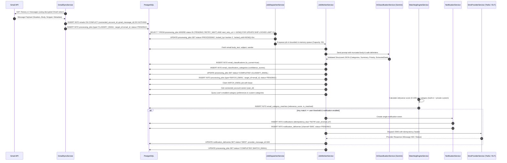

# InboxIQ – High-Level Design (HLD) v2.0
**AI-Powered Context-Aware Email Intelligence & Notification Platform**

---

## 1. Executive Summary & Problem Statement

### 1.1 The Problem
Modern professionals receive dozens or hundreds of emails daily. Critical messages—such as job interview invitations, brand sponsorships, academic offers, financial notices, or urgent travel alerts—regularly get lost beneath newsletters, spam, and routine promotional traffic. Traditional email providers offer manual folders, labels, and rule-based filters, which require continuous manual maintenance and cannot comprehend semantic intent, context, or personal user priorities.

### 1.2 Our Solution
**InboxIQ** is a multi-user SaaS intelligence layer built on top of Gmail (via Google OAuth 2.0 and the Gmail API). It does **not** replace Gmail; instead, it operates as an autonomous background intelligence engine that:
1. Ingests incoming emails reliably without blocking user operations.
2. Performs **Global AI Multi-Label Classification** and structured extraction across 11 standard industry categories using Google Gemini via Spring AI.
3. Evaluates email relevance against **User-Specific Category Preferences** and **Private Custom Categories**, calculating a deterministic relevance score (0–100).
4. Generates a **single consolidated notification event** per email per user, dispatching high-priority alerts via SMS (Twilio or Indian DLT SMS) and tracking delivery end-to-end.

---

## 2. System Goals and Non-Goals

### 2.1 Goals
- **Strict Multi-Tenant Isolation:** Complete isolation of emails, OAuth tokens, preferences, and notifications per user.
- **Multi-Label Global Classification:** Classify an email into one or more of 11 built-in categories in a single AI pass.
- **User-Specific Custom Category Matching:** Evaluate private custom categories during matching without polluting global classification taxonomy.
- **Zero Ingestion Latency Overhead:** Decouple Gmail ingestion from AI classification using durable PostgreSQL-backed jobs.
- **Lease-Based Job Concurrency:** Prevent duplicate processing, race conditions, and hung jobs using `FOR UPDATE SKIP LOCKED` with time-bounded leases.
- **Reliable SMS Dispatch & Deduplication:** Ensure users receive exactly one SMS notification per important email regardless of how many categories matched.
- **Security & Privacy First:** AES-256-GCM encrypted refresh tokens with AAD, minimal `gmail.readonly` OAuth scopes, prompt injection defense, and configurable data retention.

### 2.2 Non-Goals (Out of Scope for MVP)
- Not an email client (no drafting, sending, or deleting emails via Gmail).
- No microservices architecture; built strictly as a **Modular Monolith**.
- No RabbitMQ, Kafka, or external message broker; PostgreSQL serves as the durable queue.
- No separate Python AI service; Spring AI in Java 21 handles all LLM orchestrations.
- Google Cloud Pub/Sub push synchronization is deferred to Phase 9 (MVP utilizes scheduled incremental polling via the Gmail History API).

---

## 3. Technology Stack & Justification

| Layer / Concern | Technology Selected | Rationale & Architectural Justification |
|---|---|---|
| **Backend Runtime** | Java 21 (LTS) | Virtual threads (Project Loom), modern pattern matching, strong enterprise typing, and long-term support. |
| **Backend Framework** | Spring Boot 3.3+ | Robust ecosystem, production-grade security, enterprise transaction management, and first-class Spring AI integration. |
| **Security & Auth** | Spring Security + JWT | Stateless access tokens (15m expiry) in HttpOnly cookies + rotated refresh tokens stored hashed in DB with family reuse detection. |
| **Primary Database** | PostgreSQL 15+ | ACID compliance, JSONB for flexible category configs, partial unique indexes for classification versioning, and row-level locking (`FOR UPDATE SKIP LOCKED`). |
| **Schema Migration** | Flyway | Strict, reproducible, version-controlled migrations (`V1__...sql`). Hibernate `ddl-auto=update` is explicitly forbidden in production. |
| **AI Integration** | Spring AI (Gemini Provider) | Native Java abstraction over LLMs. Enables seamless provider swapping (Gemini 1.5 Pro/Flash to OpenAI/Anthropic) without rewriting business logic. |
| **Email Integration** | Google Gmail API v1 | Official Google SDK with minimal `https://www.googleapis.com/auth/gmail.readonly` OAuth 2.0 scope. |
| **Frontend Framework** | Next.js 14+ (App Router) | High-performance React framework, server-side rendering, strong TypeScript support, and SEO/dashboard agility. |
| **UI & Styling** | Tailwind CSS + shadcn/ui + Lucide | Consistent, accessible, modern SaaS component library without bulky UI dependencies. |
| **Background Processing** | PostgreSQL Queue + ThreadPool | Zero additional infrastructure. Durable jobs in PostgreSQL with in-memory execution buffer (`ThreadPoolTaskExecutor` + `BlockingQueue`). |
| **SMS Notification** | Twilio / Indian DLT Provider | Configurable provider abstraction (`SmsProvider` interface). Complies with Indian TRAI DLT regulations when deploying in India. |
| **Containerization** | Docker + Docker Compose | Parity between local development and cloud deployment environments. |

---

## 4. System Architecture Diagram

```mermaid
flowchart TD
    subgraph Client["Client Layer"]
        UI["Next.js 14+ Frontend (Vercel / Web Browser)"]
    end

    subgraph ExternalAuth["External Identity & Auth"]
        GoogleOAuth["Google OAuth 2.0 Consent & Token Service"]
    end

    subgraph BackendApp["InboxIQ Modular Monolith (Java 21 / Spring Boot)"]
        direction TB

        subgraph Ingress["Web & Ingress Controllers"]
            AuthController["AuthController (/api/v1/auth)"]
            AccountController["AccountController (/api/v1/accounts)"]
            EmailController["EmailController (/api/v1/emails)"]
            CategoryController["CategoryController (/api/v1/categories)"]
            NotificationController["NotificationController (/api/v1/notifications)"]
            AnalyticsController["AnalyticsController (/api/v1/analytics)"]
            WebhookController["WebhookController (/api/v1/webhooks)"]
        end

        subgraph SecurityFilter["Security & Auth Filter"]
            JwtFilter["JwtAuthenticationFilter (Access Token 15m)"]
            CsrfFilter["CsrfValidationFilter / Origin Check"]
            AuthService["AuthService & RefreshTokenRotation"]
        end

        subgraph DomainServices["Core Domain Services"]
            GmailSyncService["GmailSyncService (History API)"]
            TokenEncryption["TokenEncryptionService (AES-256-GCM + AAD)"]
            JobDispatcherService["JobDispatcherService (@Scheduled + Cloud Scheduler)"]
            JobWorkerService["JobWorkerService (Lease Manager & ThreadPool)"]
            AiClassificationService["AiClassificationService (Spring AI)"]
            MatchingEngineService["MatchingEngineService (User Preference Matcher)"]
            NotificationService["NotificationService (Event Deduplication)"]
            SmsProviderService["SmsProviderService (Twilio / Indian DLT Provider)"]
        end
    end

    subgraph Database["PostgreSQL 15+ (Cloud SQL / Managed Instance)"]
        direction TB
        UsersTable["users & auth_sessions"]
        AccountsTable["connected_accounts"]
        EmailsTable["emails & email_attachments"]
        CategoriesTable["categories (System & Custom)"]
        PrefsTable["user_category_preferences & notification_preferences"]
        ClassificationsTable["email_classifications (1:N, is_current partial unique)"]
        MatchesTable["email_category_matches"]
        NotificationsTable["notifications & notification_deliveries"]
        JobsTable["processing_jobs (FOR UPDATE SKIP LOCKED) & processing_attempts"]
    end

    subgraph ExternalServices["External APIs & Providers"]
        GmailAPI["Google Gmail API v1 (gmail.readonly)"]
        GeminiAPI["Google Gemini 1.5 Pro / Flash via Spring AI"]
        SmsGateway["SMS Gateway (Twilio / MSG91 DLT)"]
    end

    UI -->|HTTPS + HttpOnly Cookies| SecurityFilter
    SecurityFilter --> Ingress
    Ingress --> DomainServices

    UI -.->|OAuth Redirect| GoogleOAuth
    GoogleOAuth -.->|Authorization Code| Ingress

    DomainServices --> Database
    GmailSyncService -->|OAuth Token| GmailAPI
    AiClassificationService -->|Prompt (Untrusted Data Bound)| GeminiAPI
    SmsProviderService -->|HTTP REST| SmsGateway

    JobDispatcherService -->|Lease Claim FOR UPDATE SKIP LOCKED| JobsTable
    JobWorkerService -->|Execute outside DB TX| DomainServices
```

---

## 5. Architectural Corrections & Foundational Principles

### 5.1 Strict Ownership & Data Isolation (Correction 1)
In previous designs, email ingestion hinted at cross-user fan-out. In InboxIQ, strict hierarchical ownership is enforced:
```
User (1) ──► Connected Accounts (N) ──► Emails (N) ──► Email Classifications (N)
```
- Each connected Gmail account belongs to exactly **one** authenticated InboxIQ user.
- Every email retrieved belongs exclusively to that connected account and user.
- **Zero Fan-Out:** An email is never matched against or visible to any other user.
- All database queries and API endpoints must enforce `user_id = :authenticatedUserId`.

### 5.2 Two-Stage Intelligence: Global Classification vs. User-Specific Matching (Correction 2)
The intelligence pipeline is strictly divided into two decoupled stages:
1. **Stage A: Global Email Classification (AI-Driven)**
   - Operates against the canonical **11 Built-in System Categories**.
   - Gemini evaluates the preprocessed email content and extracts: multi-label categories with confidence (0.00–1.00), a concise summary (max 200 chars), priority level (`HIGH`, `MEDIUM`, `LOW`), and structured JSON entities.
   - The classification output is validated and stored with model and prompt versions.
2. **Stage B: User-Specific Matching Engine (Rule + Deterministic Scoring)**
   - Evaluates the email strictly against the **owning user's enabled preferences**.
   - For system categories: reuses the AI classification confidence and applies the user's category preference rules (keywords included/excluded, threshold filters).
   - For private **Custom Categories**: evaluates the custom category criteria against extracted entities and email summary.
   - Computes a deterministic relevance score (0–100). If `score >= min_relevance_score`, a match record is created.

### 5.3 Canonical Category Architecture (Correction 3)
InboxIQ provides exactly **11 built-in system categories**:
1. Career & Jobs
2. Creator & Brand Promotions
3. Sports
4. Education
5. Finance & Banking
6. Shopping & Offers
7. Events & Invitations
8. News & Updates
9. Technology & Product Updates
10. Travel & Bookings
11. Personal & Important Communications

- **System Categories:** `is_system = true`, `owner_user_id IS NULL`. Globally readable, immutable by users.
- **Custom Categories:** `is_system = false`, `owner_user_id = :userId`. Private to the owner, editable/deletable only by the owner. Unique per user via partial index `(name, owner_user_id) WHERE owner_user_id IS NOT NULL`.

### 5.4 Classification Versioning (Correction 4)
Emails have a **1:N relationship** with `email_classifications`.
- As AI models evolve (e.g., Gemini 1.5 Flash to future releases) or prompt templates are upgraded, emails can be reclassified without losing audit history.
- Exactly one classification is active per email, enforced by a PostgreSQL partial unique index:
  `CREATE UNIQUE INDEX idx_email_classifications_current ON email_classifications (email_id) WHERE is_current = true;`

### 5.5 Consolidated Notification Events (Correction 5)
When an email matches multiple categories for a user (e.g., an email matching both *Career & Jobs* and *Technology & Product Updates*):
- The system generates **exactly one logical Notification Event** referencing all matched category IDs and recording the highest relevance score.
- The user receives **one single SMS alert** instead of multiple spammy messages.
- An `idempotency_key = "NOTIF:" || user_id || ":" || email_id` prevents duplicate alerts across sync cycles.

### 5.6 Lease-Based Background Processing (Corrections 6 & 7)
- Persistent `processing_jobs` table in PostgreSQL acts as the durable job queue.
- Workers claim jobs using `FOR UPDATE SKIP LOCKED` inside a short transaction, acquiring a time-bounded lease (`locked_by = workerId`, `locked_until = NOW() + INTERVAL '5 minutes'`).
- Heavy operations (Gemini API calls, Gmail network calls, SMS dispatch) execute **strictly outside database transactions**, preventing connection pool starvation.
- Recovery daemon claims abandoned jobs where `status = 'PROCESSING' AND locked_until < NOW()`.

---

## 6. End-to-End Data Flows

### 6.1 Email Ingestion Flow


---

## 7. Security Architecture Summary

1. **Dual Independent Authentication Systems:**
   - **InboxIQ Application Auth:** Email/password hashed with BCrypt (strength 12), issuing 15-minute stateless JWT access tokens in HttpOnly, Secure, SameSite cookies. Refresh tokens are cryptographically random opaque tokens stored as SHA-256 hashes in `auth_sessions`, supporting automatic rotation and family reuse detection.
   - **Google OAuth 2.0:** Used solely for Gmail read access. Connecting Gmail never logs a user into InboxIQ, and logging into InboxIQ never auto-authorizes Gmail.
2. **Encrypted Credentials at Rest:**
   - Google OAuth refresh tokens are encrypted using **AES-256-GCM** with a 96-bit random nonce/IV, a 128-bit authentication tag, and Additional Authenticated Data (`AAD = accountId + ":" + userId + ":" + keyVersion`).
   - The master key is loaded via `TOKEN_ENCRYPTION_KEY` environment variable (managed in GCP Secret Manager in production).
3. **Prompt Injection & Untrusted Content Security:**
   - Raw email bodies are treated as untrusted data, stripped of executable HTML/scripts, truncated to token budgets, and wrapped in strict delimiter boundaries (`[EMAIL_START] ... [EMAIL_END]`).
   - The system prompt explicitly commands the LLM to ignore embedded instructions.
   - The AI output is validated strictly against a JSON Schema. The AI is granted zero execution permissions (cannot query DB, send emails, or run code).
4. **Data Retention & Privacy Compliance:**
   - Full email bodies are stored under a configurable retention schedule (`body_retention_until`), after which raw bodies are wiped while retaining structured classification metadata.
   - Account deletion performs an orchestrated revocation with Google (`https://oauth2.googleapis.com/revoke`), deletes encrypted tokens, purges email content, and cleanly cascades database records.

---

## 8. Deployment & Cloud Infrastructure Architecture

### 8.1 The Cloud Run Scale-to-Zero Challenge (Correction 16)
When deploying a containerized Spring Boot monolith to Google Cloud Run, default auto-scaling allows the service to scale to 0 instances when no incoming HTTP traffic arrives. If the background worker thread runs in-process, background job processing and scheduled sync jobs would freeze.

### 8.2 Production Deployment Strategy
InboxIQ resolves this reliably within a single codebase:
- **Cloud Run Deployment Configuration:**
  - `min-instances: 1`
  - `cpu-allocation: always-on` (CPU is allocated continuously, not just during request processing).
  - Memory: 1 GiB, vCPU: 1.
- **Scheduled Trigger Backup:**
  - Google Cloud Scheduler triggers a secured internal webhook (`POST /api/v1/internal/jobs/heartbeat`) every 1 minute. This ensures that even in environments where min-instances is 0 (e.g., staging), the container wakes and drains the PostgreSQL queue.
- **Database:** Managed Cloud SQL for PostgreSQL (db-f1-micro for dev, db-custom-2-7680 for production) with SSL enforced.
- **Frontend:** Deployed to Vercel with a custom domain setup (`app.inboxiq.com` frontend, `api.inboxiq.com` backend) enabling secure `SameSite=Lax` cookie sharing.

---

## 9. Architectural Decisions & Trade-off Matrix

| Decision ID | Chosen Approach | Rejected Alternative | Key Architectural Trade-off & Justification |
|---|---|---|---|
| **ADR-01** | Modular Monolith | Microservices Architecture | Avoids distributed network latency, distributed transactions, and deployment complexity for an MVP. Clear package boundaries allow future service extraction if needed. |
| **ADR-02** | PostgreSQL Persistent Job Queue | RabbitMQ / Apache Kafka | Zero additional operational infrastructure. PostgreSQL `FOR UPDATE SKIP LOCKED` provides atomic claiming, ACID transactional job creation with emails, and simple visibility. |
| **ADR-03** | Spring AI Framework | Direct Gemini SDK / Python FastAPI | Eliminates a dual-language stack. Spring AI provides clean Java abstractions, structured POJO parsing, and seamless multi-provider support. |
| **ADR-04** | Async Decoupled Processing | Synchronous Ingestion Classification | Synchronous AI calls during Gmail sync would cause HTTP timeouts and rate-limit lockouts. Decoupling via PostgreSQL queue ensures resilient retries. |
| **ADR-05** | Multi-Label AI Classification | Single-Label Classification | Real-world emails inherently bridge multiple domains (e.g., Tech news + Job alert). Multi-label classification models reality accurately. |
| **ADR-06** | Consolidated Notification Event | One SMS per matched category | Multiple matches for an email would bombard the user's phone with duplicate SMS alerts. One notification event with multiple category tags is user-friendly and cost-effective. |
| **ADR-07** | Opaque Token Refresh Rotation | Long-lived Stateless JWTs | Storing refresh token hashes in PostgreSQL enables instantaneous session revocation, logout across devices, and automated reuse compromise detection. |
| **ADR-08** | AES-256-GCM with AAD | Simple AES-CBC or Plaintext | GCM provides authenticated encryption preventing ciphertext tampering. Binding AAD to `accountId:userId` prevents ciphertext relocation across accounts. |

---

## 10. Open Questions, Technical Risks & Approval Points

1. **Indian SMS DLT Regulatory Registration (Risk Level: HIGH):**
   - In India, TRAI requires Distributed Ledger Technology (DLT) registration, pre-approved Sender IDs (6 characters), and pre-approved SMS content templates. Dynamic AI summaries in SMS may require specific template structures (e.g., `InboxIQ Alert: {#var#} email from {#var#}. Summary: {#var#}`).
2. **Gemini API Rate Limits on Initial Sync (Risk Level: MEDIUM):**
   - When a user connects a Gmail account with hundreds of unread emails, batch enqueueing can encounter Gemini API per-minute token or request quotas. The dispatcher rate limiter must be tuned to batch jobs with exponential backoff and jitter.
3. **Gmail Watch Renewal in Phase 9 (Risk Level: LOW):**
   - Gmail Pub/Sub watch subscriptions expire every 7 days. A dedicated daily scheduled job must renew all active watches with Google.

