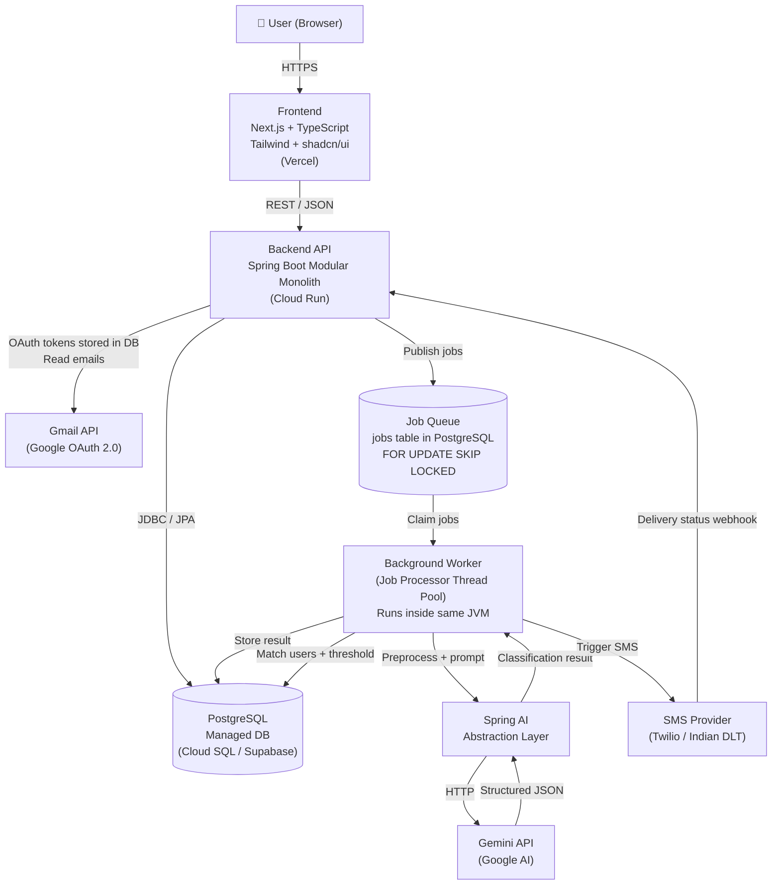
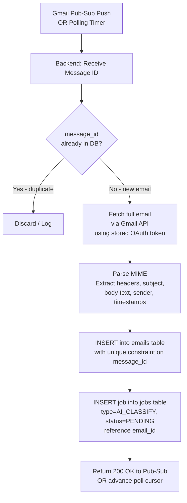
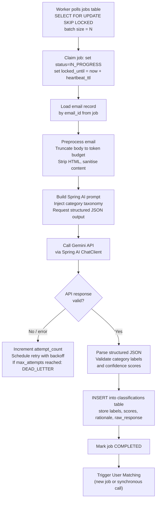
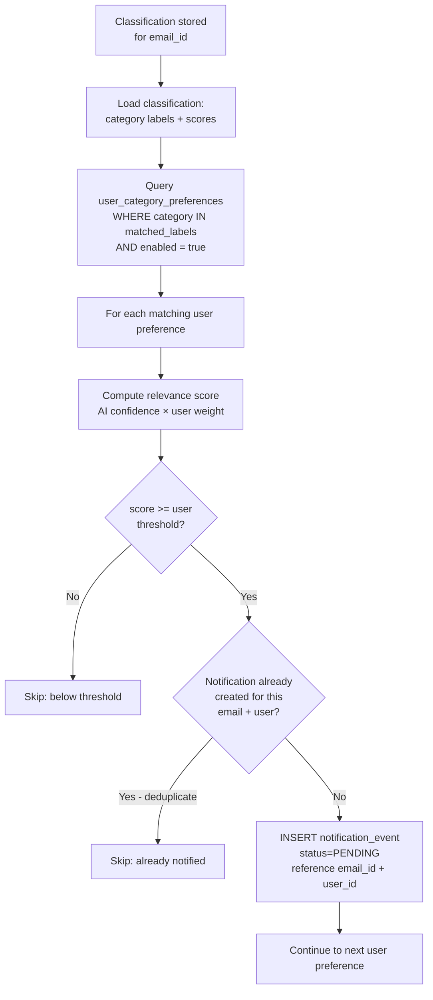
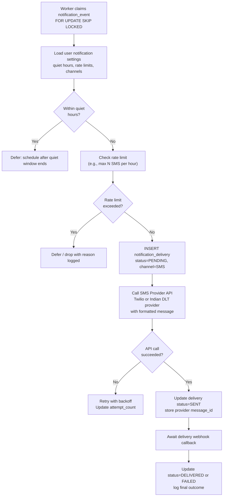
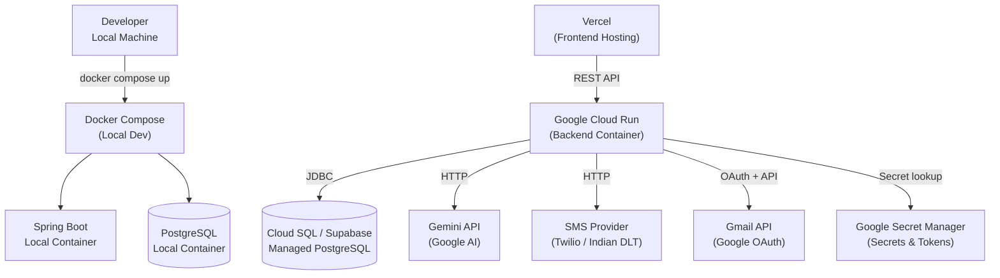

# InboxIQ — High-Level Design (HLD)

> **Version:** 1.0  
> **Status:** Draft  
> **Audience:** Engineering team, technical stakeholders, onboarding engineers

---

## Table of Contents

1. [Executive Summary](#1-executive-summary)
2. [System Goals & Non-Goals](#2-system-goals--non-goals)
3. [High-Level Architecture Diagram](#3-high-level-architecture-diagram)
4. [Component Overview](#4-component-overview)
5. [Technology Stack Decisions](#5-technology-stack-decisions)
6. [Data Flow Diagrams](#6-data-flow-diagrams)
7. [Module Boundaries](#7-module-boundaries)
8. [Security Architecture Overview](#8-security-architecture-overview)
9. [Scalability & Reliability Considerations](#9-scalability--reliability-considerations)
10. [Deployment Architecture](#10-deployment-architecture)
11. [Key Architectural Decisions & Trade-offs](#11-key-architectural-decisions--trade-offs)
12. [Open Questions / Risks](#12-open-questions--risks)

---

## 1. Executive Summary

**InboxIQ** is a multi-user SaaS platform that transforms a user's Gmail inbox into a structured, intelligent feed. Most professionals receive hundreds of emails per day across dozens of contexts—newsletters, urgent client requests, CI/CD alerts, billing notices, and more. The signal-to-noise ratio is poor, and important messages are missed.

InboxIQ solves this by:

1. **Connecting** to a user's Gmail account via Google OAuth 2.0 (read-only).
2. **Ingesting** incoming emails and storing them in a structured, deduplicated store.
3. **Classifying** each email into one or more categories using an AI pipeline built on Spring AI and Google Gemini.
4. **Matching** classification results against each user's configured category preferences and relevance thresholds.
5. **Notifying** the user via SMS when a high-relevance email arrives—so they can act without constantly checking their inbox.

The system is built as a **Modular Monolith** using Java 21 + Spring Boot, backed by PostgreSQL, with a Next.js frontend. The architecture prioritises operational simplicity, strong data consistency, and a clear path to scale.

---

## 2. System Goals & Non-Goals

### Goals

| # | Goal | Detail |
|---|------|--------|
| G1 | Multi-user SaaS | Each user has an isolated account with their own Gmail connections, categories, and notification preferences |
| G2 | Gmail integration | Connect one or more Gmail accounts per user via Google OAuth 2.0 |
| G3 | AI-powered email classification | Multi-label classification using Spring AI + Gemini; each email can belong to multiple categories |
| G4 | User-defined categories & preferences | Built-in taxonomy plus custom categories; per-category relevance thresholds |
| G5 | SMS notifications | Notify users via SMS when a high-relevance email is detected |
| G6 | Background processing | Persistent, durable job queue for async AI processing; survives application restarts |
| G7 | Dashboard analytics | Provide users with visibility into email volume, category distribution, and notification history |

### Non-Goals

| # | Non-Goal | Rationale |
|---|----------|-----------|
| NG1 | Replace Gmail | InboxIQ is a read-only intelligence layer; it does not send emails or manage the inbox |
| NG2 | Microservices architecture | Premature for MVP; a Modular Monolith delivers equivalent separation of concerns with far less operational overhead |
| NG3 | Python AI service | Spring AI provides a vendor-agnostic Java-native AI abstraction; a separate Python service adds a network hop and deployment complexity |
| NG4 | RabbitMQ or external message broker | PostgreSQL's `FOR UPDATE SKIP LOCKED` delivers durable, concurrent job processing without an additional infrastructure dependency |
| NG5 | Email sending / reply management | Out of scope; read-only integration only |
| NG6 | Support for email providers other than Gmail | Phase 1 is Gmail-only; Outlook and others may follow |

---

## 3. High-Level Architecture Diagram



### Processing Pipeline Detail

```mermaid
flowchart LR
    Ingest["Email Ingestion\n(Gmail poll / Pub-Sub)"]
    Dedup["Dedup Check\n(message_id unique)"]
    Store["Store Email\n(emails table)"]
    JobCreate["Create Processing Job\n(jobs table, status=PENDING)"]
    Claim["Worker Claims Job\nFOR UPDATE SKIP LOCKED"]
    AIPrep["Preprocess Email\n(truncate, sanitise)"]
    Prompt["Spring AI Prompt\n(structured output)"]
    GeminiCall["Gemini API Call"]
    Validate["Validate + Parse\nClassification JSON"]
    SaveClass["Store Classification\n(classifications table)"]
    Match["User Matching Engine\nScore per user preferences"]
    NotifEvent["Notification Event\n(notifications table)"]
    SendSMS["Send SMS\n(provider API)"]
    UpdateStatus["Update Delivery Status"]

    Ingest --> Dedup
    Dedup -->|New email| Store
    Store --> JobCreate
    JobCreate --> Claim
    Claim --> AIPrep
    AIPrep --> Prompt
    Prompt --> GeminiCall
    GeminiCall --> Validate
    Validate --> SaveClass
    SaveClass --> Match
    Match -->|score >= threshold| NotifEvent
    NotifEvent --> SendSMS
    SendSMS --> UpdateStatus
```



---

## 4. Component Overview

### 4.1 Frontend Dashboard (Next.js)

The user-facing single-page application. Provides:
- **Account management:** OAuth flow initiation, connected Gmail account list.
- **Category configuration:** Browse built-in categories, create custom categories, set per-category relevance thresholds and notification channels.
- **Email feed:** Paginated view of ingested emails with their classification labels and relevance scores.
- **Notification history:** Audit trail of SMS notifications sent.
- **Analytics dashboard:** Charts for email volume, category distribution, and notification counts.

Communicates exclusively with the Backend API over HTTPS REST/JSON. No direct database or Gmail API access.

---

### 4.2 Backend API (Spring Boot Modular Monolith)

The single deployable unit that hosts all backend logic. Organised into well-defined internal modules (Java packages with explicit interfaces) that enforce separation of concerns without the operational overhead of microservices.

Responsibilities:
- Expose REST endpoints consumed by the frontend.
- Orchestrate Gmail OAuth flows and token lifecycle.
- Trigger and manage email ingestion.
- Publish jobs to the PostgreSQL-backed job queue.
- Expose webhook endpoints for Gmail Pub/Sub and SMS delivery status callbacks.

---

### 4.3 Authentication Module

Handles InboxIQ-native user identity (separate from Gmail OAuth):
- User registration and login.
- Password hashing (BCrypt).
- JWT issuance and validation (or server-side sessions).
- Refresh token rotation.

> [!IMPORTANT]
> InboxIQ authentication (who is logged into InboxIQ) and Gmail OAuth (which Gmail accounts are connected) are **entirely separate concerns** and must never be conflated.

---

### 4.4 Gmail Integration Module

Manages the lifecycle of a user's Gmail connection:
- Initiates Google OAuth 2.0 authorization code flow.
- Exchanges the authorization code for access + refresh tokens.
- Stores refresh tokens **encrypted at rest** in PostgreSQL.
- Refreshes access tokens on demand, with concurrency-safe locking.
- Establishes Gmail API watchers (Pub/Sub push) for real-time delivery.
- Falls back to periodic polling when push is unavailable.
- Manages OAuth revocation on user disconnect.

---

### 4.5 Email Ingestion & Storage

- Fetches raw email messages from the Gmail API using stored (refreshed) access tokens.
- Parses MIME structure: headers, subject, body (text/html → plain text), sender, recipients, timestamps.
- Performs **deduplication** using Gmail's stable `message_id` with a unique database constraint — prevents reprocessing on polling overlap or webhook replay.
- Stores normalised email metadata and body in the `emails` table.
- After successful storage, creates a `PENDING` job in the `jobs` table to trigger the AI pipeline.

---

### 4.6 Background Job Processor

A thread-pool-backed scheduler that runs **inside the same JVM** as the Spring Boot application:
- Periodically polls the `jobs` table for `PENDING` jobs using `SELECT ... FOR UPDATE SKIP LOCKED`.
- Claims a batch of jobs atomically — no two workers will claim the same job.
- Dispatches jobs to the appropriate handler (e.g., `AI_CLASSIFY`, `SEND_NOTIFICATION`).
- On success: marks the job `COMPLETED`.
- On failure: increments `attempt_count`, applies exponential backoff to `next_attempt_at`, and moves to `FAILED` after `max_attempts`.
- Supports a **recovery sweep** that reschedules `IN_PROGRESS` jobs abandoned due to crashes (via a `locked_until` heartbeat column).

---

### 4.7 AI Classification Engine (Spring AI + Gemini)

The intelligence core of InboxIQ:
- Receives a preprocessed email (subject + body, truncated to token budget).
- Constructs a structured prompt via Spring AI's `ChatClient` with explicit output schema.
- Calls the Gemini API and receives a **structured JSON response** containing:
  - A list of matched category labels.
  - Per-category confidence scores.
  - A short rationale for each label (useful for debugging and display).
- Validates and parses the response; retries with exponential backoff on API errors or malformed output.
- Stores the raw prompt + response for auditability and prompt iteration.

---

### 4.8 Category & Preference Engine

Manages the category taxonomy and per-user configuration:
- **Built-in categories** (seeded via Flyway): `URGENT`, `BILLING`, `NEWSLETTERS`, `SECURITY_ALERTS`, `CI_CD`, `SOCIAL`, `PROMOTIONS`, `TRAVEL`, etc.
- **Custom categories**: Users can define their own labels with custom descriptions that are injected into the AI prompt.
- **User preferences**: Per-category toggle (enabled/disabled), relevance threshold (0.0–1.0), preferred notification channel (SMS, in-app, none), and JSONB field for future extensibility (e.g., keyword overrides).

---

### 4.9 User-Specific Matching Engine

After classification, determines which users should be notified:
- Loads the classification result for the email.
- Queries users who have that Gmail account connected AND have a category preference for one of the matched labels.
- Computes a relevance score (AI confidence × user-configured weight or threshold).
- If score ≥ user threshold: creates a `notification_event` record.
- Deduplicates: a single email triggers **at most one SMS notification per user** regardless of how many categories match, to prevent spam.

---

### 4.10 Notification System

Delivers notifications reliably across channels:
- Reads pending `notification_events`.
- Checks the user's active notification channels and delivery preferences (quiet hours, rate limits).
- Creates a `notification_delivery` record (status: `PENDING`).
- Calls the SMS provider API (Twilio or Indian DLT-registered provider).
- Updates delivery status on webhook callback (`DELIVERED`, `FAILED`).
- Retries failed deliveries up to a configured limit.

---

### 4.11 PostgreSQL Database

The single source of truth for all persistent state:
- **Relational integrity:** Foreign keys enforce referential consistency across users, accounts, emails, jobs, classifications, and notifications.
- **JSONB columns:** Used for flexible, schema-free data like per-category user preferences and AI response metadata.
- **UUID primary keys:** All entities use `UUID` PKs (generated application-side or via `gen_random_uuid()`) to prevent enumeration attacks and support a distributed-future path.
- **Row-level locking:** `FOR UPDATE SKIP LOCKED` powers the job queue without an external broker.
- **Schema managed by Flyway:** No `ddl-auto=update`; all schema changes are versioned migrations in `src/main/resources/db/migration/`.

---

## 5. Technology Stack Decisions

| Technology | Category | Why Chosen |
|-----------|----------|------------|
| **Java 21** | Language | LTS release; virtual threads (Project Loom) available for I/O-heavy background workers; mature ecosystem; strong typing catches errors at compile time |
| **Spring Boot 3.x** | Framework | Industry-standard for Java SaaS; autoconfiguration reduces boilerplate; first-class Spring AI, Security, Data JPA integration |
| **Spring AI** | AI abstraction | Vendor-agnostic `ChatClient` API; supports Gemini today, OpenAI/Anthropic tomorrow without rewriting business logic; structured output support; built-in retry and observability hooks |
| **Google Gemini API** | AI model | Strong multimodal reasoning; competitive pricing; native Spring AI adapter; aligns with Google Cloud deployment target |
| **PostgreSQL** | Database | ACID transactions; JSONB for flexible metadata; UUID support; `FOR UPDATE SKIP LOCKED` enables a durable job queue; row-level security available for future multi-tenancy hardening |
| **Flyway** | Schema migration | Version-controlled, repeatable migrations; `ddl-auto=update` is dangerous in production — Flyway enforces an explicit change history |
| **Next.js 14+ (App Router)** | Frontend framework | Server components for fast initial load; built-in API routes for BFF patterns; TypeScript-first; large ecosystem |
| **TypeScript** | Frontend language | Type safety across frontend codebase; better IDE support; reduces runtime errors |
| **Tailwind CSS** | Styling | Utility-first; no CSS bundle bloat; consistent design tokens |
| **shadcn/ui** | Component library | Accessible, unstyled-then-styled Radix primitives; components are owned (not a node_modules dependency), so they can be freely customised |
| **Modular Monolith** | Architecture pattern | Single deployable JAR with internal module boundaries; avoids distributed systems complexity (network partitions, distributed tracing, service discovery) at MVP scale; easy to extract a service later if needed |
| **PostgreSQL-backed job queue** | Background processing | Avoids a separate RabbitMQ/Redis deployment; jobs are durable (survive restarts); transactionally consistent with other writes; `FOR UPDATE SKIP LOCKED` enables concurrent workers without double-processing |
| **Google OAuth 2.0** | Gmail auth | Industry standard; Gmail API requires it; read-only scope limits blast radius of a token compromise |
| **Twilio / Indian SMS provider** | Notifications | Twilio: global coverage, excellent reliability, webhooks; Indian providers (e.g., MSG91, Fast2SMS): mandatory for India-originated traffic (DLT registration required); chosen based on deployment region |
| **Docker / Cloud Run** | Deployment | Containerised backend; Cloud Run scales to zero (cost-efficient for MVP); managed infrastructure reduces operational burden |
| **Vercel** | Frontend hosting | Zero-config Next.js deployment; edge CDN; preview deployments per PR |

---

## 6. Data Flow Diagrams

### 6a. Email Ingestion Flow



### 6b. AI Processing Flow



### 6c. User Matching Flow



### 6d. Notification Flow



---

## 7. Module Boundaries

Each module is a Java package with a clearly defined public API (service interfaces and DTOs). Cross-module calls go through these interfaces only — never direct repository access across module boundaries.

| Module | Package | Responsibilities |
|--------|---------|-----------------|
| **auth** | `com.inboxiq.auth` | User registration, login, JWT issuance and validation, refresh token rotation, password hashing |
| **user** | `com.inboxiq.user` | User profile management, settings (timezone, locale, notification preferences), account deletion |
| **account** | `com.inboxiq.account` | Gmail account connection, Google OAuth 2.0 flow, access/refresh token storage and refresh, Pub/Sub watch management |
| **email** | `com.inboxiq.email` | Email storage, MIME parsing, deduplication, metadata indexing, body retrieval |
| **processing** | `com.inboxiq.processing` | Job queue management, worker thread pool, job dispatch, retry logic, exponential backoff, dead-letter handling, heartbeat/recovery sweep |
| **ai** | `com.inboxiq.ai` | Spring AI integration, Gemini `ChatClient` configuration, prompt templates, structured output parsing, AI call observability |
| **classification** | `com.inboxiq.classification` | Multi-label classification result persistence, category taxonomy, classification versioning, historical result retrieval |
| **category** | `com.inboxiq.category` | Built-in and custom category CRUD, user category preference CRUD, per-category threshold and channel config |
| **matching** | `com.inboxiq.matching` | User-specific relevance score computation, preference-to-classification matching, notification event creation, deduplication guard |
| **notification** | `com.inboxiq.notification` | Notification event processing, delivery record management, SMS provider integration, delivery status webhook handling, quiet hours / rate limiting |
| **analytics** | `com.inboxiq.analytics` | Aggregated metrics queries: email volume by day, category distribution, notification rates, top senders |
| **common** | `com.inboxiq.common` | Shared exceptions, base DTOs, pagination utilities, audit fields (`created_at`, `updated_at`), API response envelope |
| **config** | `com.inboxiq.config` | Spring Security configuration, CORS settings, bean definitions, environment-specific property binding, Flyway configuration |

> [!NOTE]
> Module boundaries are enforced by code review and, optionally, by ArchUnit tests that assert no cross-module repository access. The processing module is the only module allowed to call across other modules' service interfaces at runtime.

---

## 8. Security Architecture Overview

### 8.1 Authentication Layers

InboxIQ operates with two independent authentication concerns:

| Concern | Mechanism | Scope |
|---------|-----------|-------|
| InboxIQ user auth | JWT (or server-side session) | Protects all InboxIQ API endpoints |
| Gmail OAuth | Google OAuth 2.0 authorization code flow | Grants read-only access to a specific Gmail inbox |

These must never be confused. A user logs into InboxIQ with email/password; separately, they authorise InboxIQ to read their Gmail.

### 8.2 OAuth Token Security

- Gmail refresh tokens are encrypted at rest using AES-256 with a KMS-managed key (or application-level encryption via Jasypt/Spring Vault for MVP).
- Access tokens are short-lived and stored only in memory or with a short DB TTL.
- Token refresh is performed with application-level locking (database-backed) to prevent concurrent refresh storms on the same account.

### 8.3 Data Isolation

- **Every database query is scoped to `userId`** — no query returns data belonging to another user.
- Repository-layer filters are applied by default; `@PostAuthorize` annotations add a defence-in-depth check at the service layer.
- Row-level security (PostgreSQL RLS) is a future hardening option.

### 8.4 Gmail Scope Minimisation

- InboxIQ requests only `https://www.googleapis.com/auth/gmail.readonly`.
- It never requests send, modify, or delete scopes.
- Users can revoke access at any time from both InboxIQ and their Google Account settings.

### 8.5 Prompt Injection Protection

- Email subject and body are treated as **data inputs**, never as instructions.
- The AI prompt template clearly delineates the system instruction from the user-provided email content using explicit delimiters.
- Output is parsed as structured JSON via Spring AI's structured output facility — raw LLM text is never executed or rendered as HTML.

### 8.6 Additional Controls

| Control | Detail |
|---------|--------|
| Input validation | Bean Validation (`@Valid`) on all request DTOs; SQL injection prevented by parameterised queries (JPA/Hibernate) |
| No sensitive data in logs | Logback configuration redacts token values, email bodies, and phone numbers from logs |
| CORS | Strict allowlist of frontend origin(s); no wildcard in production |
| HTTPS | TLS enforced end-to-end (Vercel → Cloud Run via HTTPS; no plain HTTP in production) |
| Secrets management | Environment variables / Google Secret Manager; no secrets in source code or Docker images |

---

## 9. Scalability & Reliability Considerations

### 9.1 Job Queue Durability

- All processing jobs are persisted to PostgreSQL before the ingestion response is returned.
- If the application crashes mid-processing, jobs remain in `IN_PROGRESS` state. The recovery sweep (runs every minute) reschedules any job where `locked_until < now()` back to `PENDING`.
- No work is lost across restarts.

### 9.2 Concurrent Job Processing

- `SELECT ... FOR UPDATE SKIP LOCKED` atomically claims a batch of jobs; two workers in the same JVM (or in different pods) cannot claim the same job.
- Worker thread-pool size is configurable; tuning is straightforward without infrastructure changes.

### 9.3 AI Retry & Backoff

- Gemini API call failures (rate limits, transient errors) trigger exponential backoff: `base_delay × 2^attempt` with jitter, capped at a maximum delay.
- Max attempt count is configurable per job type.
- Permanently failed jobs are moved to `DEAD_LETTER` status and surfaced in an admin view for manual review.

### 9.4 Notification Deduplication

- A unique constraint on `(email_id, user_id)` in `notification_events` prevents double-notification even if the matching engine runs twice due to a retry.
- An `INSERT ... ON CONFLICT DO NOTHING` pattern is used at the application layer.

### 9.5 Classification Versioning

- Each classification record stores the `model_version` and `prompt_version` used.
- When the AI model or prompt changes, historical classifications are not overwritten — new classifications are appended.
- This enables A/B comparison and controlled re-classification rollouts.

### 9.6 Horizontal Scaling Path

- The Spring Boot backend is **stateless** (JWTs, no sticky sessions; job queue in DB).
- Scaling from 1 to N Cloud Run instances requires no architectural changes — each instance runs its own worker thread pool, and `FOR UPDATE SKIP LOCKED` handles concurrent job claiming safely.
- The bottleneck at scale is the managed PostgreSQL instance; read replicas and connection pooling (PgBouncer) are the standard remediation.

---

## 10. Deployment Architecture



### Environment Summary

| Environment | Frontend | Backend | Database | Notes |
|-------------|----------|---------|----------|-------|
| **Local Dev** | `next dev` on localhost | Spring Boot local or Docker container | PostgreSQL Docker container | `.env.local` for secrets |
| **Staging** | Vercel preview deployment | Cloud Run (staging revision) | Cloud SQL (staging instance) | Auto-deploy on PR merge to `develop` |
| **Production** | Vercel production | Cloud Run (production revision, min-instances=1) | Cloud SQL (production, with PITR backup) | Tagged release triggers deploy |

### Local Development with Docker Compose

```yaml
# docker-compose.yml (illustrative)
services:
  postgres:
    image: postgres:16
    environment:
      POSTGRES_DB: inboxiq
      POSTGRES_USER: inboxiq
      POSTGRES_PASSWORD: dev_password
    ports:
      - "5432:5432"
    volumes:
      - postgres_data:/var/lib/postgresql/data

  backend:
    build: ./backend
    ports:
      - "8080:8080"
    environment:
      SPRING_DATASOURCE_URL: jdbc:postgresql://postgres:5432/inboxiq
    depends_on:
      - postgres
```

---

## 11. Key Architectural Decisions & Trade-offs

### Decision 1: Modular Monolith vs Microservices

| Aspect | Modular Monolith (chosen) | Microservices (rejected) |
|--------|--------------------------|--------------------------|
| Operational complexity | Low — single JAR, single deployment | High — service mesh, distributed tracing, service discovery |
| Development velocity | High — in-process calls, shared types | Lower — API contracts, versioning overhead |
| Data consistency | Strong — single transactional database | Eventual consistency, saga patterns required |
| Scaling granularity | Coarse — scale the whole app | Fine — scale individual services |
| Extraction path | Clear — module → service when needed | Already extracted |

**Decision:** Modular Monolith for MVP. Module boundaries are designed to allow extraction into services post-PMF if a specific module (e.g., AI classification) needs independent scaling.

---

### Decision 2: PostgreSQL Job Queue vs RabbitMQ

| Aspect | PostgreSQL Queue (chosen) | RabbitMQ (rejected) |
|--------|--------------------------|---------------------|
| Infrastructure components | 0 extra (DB already required) | 1 extra (RabbitMQ cluster) |
| Durability | Transactional — job created with email atomically | Requires publisher confirms + persistent queues |
| Concurrent claiming | `FOR UPDATE SKIP LOCKED` — safe and efficient | Built-in |
| Operational overhead | None beyond existing DB management | Requires monitoring, clustering, TLS config |
| At-scale throughput | Good for 100s–1000s jobs/sec | Better for 10,000s+ jobs/sec |

**Decision:** PostgreSQL queue. At InboxIQ's expected scale (email ingestion volume per user × number of users), PostgreSQL is more than sufficient. RabbitMQ can be introduced if throughput profiling proves it necessary.

---

### Decision 3: Spring AI Abstraction Layer

**Rationale:** Spring AI's `ChatClient` decouples business logic from any specific AI provider. The prompt templates, structured output parsing, and retry logic all sit in the `ai` module. Swapping from Gemini to OpenAI GPT-4o or Anthropic Claude requires changing a dependency and configuration — not rewriting the classification pipeline.

**Trade-off:** Spring AI is a younger project; its Gemini adapter may lag behind the native Gemini SDK for cutting-edge features. Mitigation: the `ai` module wraps Spring AI, so a native SDK fallback is localised.

---

### Decision 4: Async AI Processing

**Rationale:** Gemini API latency (1–5+ seconds per call) must never block the email ingestion response. Ingestion returns immediately after writing the email and job to the database. The AI pipeline runs asynchronously via the job queue.

**Trade-off:** Classification results are not immediately available after ingestion. The UI reflects this with a "Processing…" status that resolves within seconds for most emails.

---

### Decision 5: Multi-Label Classification

**Rationale:** A single email can legitimately belong to multiple categories (e.g., a CI/CD failure email is both `CI_CD` and `URGENT`). Single-label classification would require the AI to pick one, discarding signal. Multi-label classification returns all applicable categories with confidence scores.

**Trade-off:** Matching engine must handle multiple labels per email, and deduplication (Decision 6) becomes necessary.

---

### Decision 6: Single Notification Event Per Email Per User

**Rationale:** If an email matches 3 of a user's configured categories, sending 3 SMS messages is spammy and defeats the purpose of intelligent filtering. The matching engine creates at most one `notification_event` per `(email_id, user_id)` pair, using the highest-scoring matched category as the notification context.

**Trade-off:** A user configured for both `BILLING` and `URGENT` will receive only one SMS for a billing alert marked urgent; the SMS message should include both matched labels for context.

---

### Decision 7: JSONB for Category Preferences

**Rationale:** Per-category user preferences may evolve (keyword overrides, custom prompt hints, channel-specific settings per category). Storing extension data in a JSONB `metadata` column avoids schema migrations for every new preference field.

**Trade-off:** JSONB fields are not easily queryable with indexes unless explicitly defined. Core preference fields (threshold, enabled, channel) remain as typed relational columns; only extension data goes into JSONB.

---

### Decision 8: UUID Primary Keys

**Rationale:** Sequential integer PKs expose record counts and enable enumeration attacks (e.g., `/api/emails/1`, `/api/emails/2`). UUIDs are unguessable, safe to include in public-facing URLs, and compatible with a future distributed or partitioned database.

**Trade-off:** UUIDs are larger (16 bytes vs 4/8 bytes) and slightly degrade B-tree index locality. At InboxIQ's expected scale this is immaterial; if it becomes an issue, `UUIDv7` (time-ordered) can be adopted without changing the type.

---

## 12. Open Questions / Risks

| # | Risk / Question | Severity | Mitigation / Owner |
|---|----------------|----------|-------------------|
| R1 | **Indian SMS DLT registration:** Indian TRAI regulations require DLT (Distributed Ledger Technology) registration for all commercial SMS traffic — a process that takes 2–4 weeks and requires a registered entity. | High | Register early; use Twilio international as fallback during registration; confirm provider (MSG91, Fast2SMS, Exotel) |
| R2 | **Gemini API rate limits during bulk sync:** When a user first connects Gmail and triggers a historical sync of 1,000s of emails, job throughput will be limited by Gemini's RPM/TPM quota. | High | Implement per-account ingestion rate limiting; use dedicated Gemini project quota; consider tiered sync (last 7 days first, then older) |
| R3 | **Gmail OAuth token refresh concurrency:** Multiple worker threads processing emails from the same Gmail account may simultaneously detect token expiry and attempt refresh, causing race conditions with Google's token rotation. | Medium | Use a database-level advisory lock or optimistic locking on the token refresh operation; cache the refreshed token for 50 minutes |
| R4 | **Gmail Pub/Sub watch renewal (Phase 2+):** Gmail push notifications via Pub/Sub require periodic watch renewal (every 7 days). Missing renewal silently falls back to no push notifications. | Medium | Scheduled job renews all active watches 24 hours before expiry; alert on renewal failures |
| R5 | **GDPR / data retention for email content:** Storing email body content constitutes processing of personal data. Users in the EU have the right to erasure. | High | Implement per-user data deletion (email body purge while retaining metadata); define and document data retention policy; consult legal |
| R6 | **Cost estimation for AI calls at scale:** At scale, every email ingested incurs a Gemini API call. At 100 emails/user/day × 10,000 users = 1M calls/day. | Medium | Implement token-budget-aware truncation; cache classifications for identical email signatures; monitor cost dashboard; expose per-tier usage quotas |
| R7 | **Spring AI Gemini adapter maturity:** Spring AI's Gemini integration may not support all Gemini features (e.g., function calling, grounding). | Low | Pin Spring AI version; monitor release notes; `ai` module encapsulates the adapter, limiting blast radius of a breaking change |
| R8 | **Background worker starvation under load:** If the worker thread pool is saturated, new jobs queue up in the DB. If the queue grows unboundedly, job latency degrades. | Medium | Monitor `jobs` table queue depth; alert on queue depth > threshold; auto-scale Cloud Run instances; tune thread pool size |

---

*Document maintained by the InboxIQ engineering team. Last updated: November 2026.*
